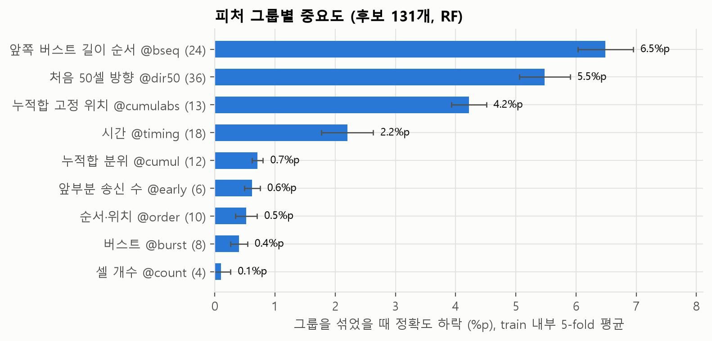

# 실험 기록

피처를 어떻게 고르고 정리했는지를 단계별로 기록한다. 각 단계는 **질문 → 가설과 근거 → 방법 → 결과 → 결정** 순서로 쓴다. 보고서의 "방법·결과" 절 초안으로 쓴다.

- 피처 정의 → [FEATURES.md](FEATURES.md)
- 코드·실행 방법 → [PREPROCESSING.md](PREPROCESSING.md)

## 공통 규칙 (실험 전에 정함)

| 항목 | 내용 |
|---|---|
| 데이터 | mon 19,000개, 사이트 95개 분류 (closed-world) |
| 분할 | train = 방문 0~17번째 (17,100개), test = 18~19번째 (1,900개) |
| 평가 | **train 내부 5-fold 교차검증(CV)** 의 평균 정확도. fold = 방문 번호 % 5. **test는 쓰지 않는다** |
| 판단 기준 | 기준 조합 대비 차이가 **1%p(≈ fold 간 표준편차) 이내면 같은 수준**으로 보고 피처가 적은 쪽을 고른다 |
| 모델 | 수업에서 다룬 모델. 하이퍼파라미터는 기본값(아래). 이 단계의 목적은 피처 비교이고 **모델 선택이 아니다** |
| 전처리 | 트리 모델(DT, RF, ET)은 원본 값. 나머지는 `sign(x)·log(1+|x|)` 후 표준화(학습 fold 기준) |
| 재현 | `python -I -X utf8 code/run_stages.py <단계>` → `logs/stage<단계>.log` (단계: 1, 2, 3, 3b, 4, 5) |

**주의 (4b단계 이후)**: `@early`·`@bseq`·`@dir50`·`@dir` 그룹에서 준상수 13개를 뺐다. 그래서 위 로그의 피처 수(131 등)를 그대로 재현하려면 명령 맨 뒤에 `@qconst`를 붙여야 한다. 정확도는 소수점 4자리까지 같다(4b단계).

기본 하이퍼파라미터: LR(max_iter=2000), NB, SVM(RBF, C=10), DT, RF(트리 200개), ET(트리 200개), k-NN(k=5), MLP(은닉 256, early stopping).

**왜 test를 쓰지 않나**: test 점수를 보면서 피처를 바꾸면 test에 우연히 맞는 조합을 고르게 된다. test는 피처와 모델이 모두 정해진 뒤 한 번만 쓴다.

**왜 같은 조합을 여러 모델에 돌리나**: 피처의 효과가 모델마다 다르다. 트리 모델은 쓸모없는 피처에 둔감하고, k-NN·SVM·LR은 거리나 선형 결합에 모든 피처가 들어가므로 민감하다.

## 0단계: 탐색 (가설 만들기)

η²(피처 하나의 사이트 구분력), 상관관계, 랜덤 포레스트 중요도로 가설을 만들었다. 자세한 결과는 [PREPROCESSING.md](PREPROCESSING.md)와 `logs/feature_importance.log`에 있다.

- 길이 계열 17개는 서로 상관 0.9 이상 → 사실상 같은 정보
- `in_burst_1~3`은 상수 → 정보 없음
- 시간 피처 18개는 RF에서 빼도 정확도가 그대로 → 다른 피처와 겹침
- 단일 피처로는 기록 앞부분의 송신 수(`first30_out`, `first100_out`)와 고정 위치 누적합(`cumul_at_500`)이 가장 중요

**한계**: permutation 중요도를 test(inst 18~19)로 계산했다. 가설을 만드는 데만 썼고 평가는 1단계부터 CV로 했지만, 엄밀하게는 train 안에서 다시 계산해야 한다.

### 0단계 재확인: train 내부에서 다시 계산 (10/16)

`code/feature_importance_cv.py base`로 같은 55개를 train(inst 0~17) 안의 5-fold로 다시 계산했다. fold마다 나머지 4개로 RF(300)를 학습하고, 빼 둔 fold에서 피처를 섞어 정확도 하락을 쟀다. test는 쓰지 않았다.

| | 0단계 (test 기준) | 재확인 (train 내부) |
|---|---|---|
| 상위 3개 | `first30_out` `first100_out` `cumul_at_500` | `first30_out` `cumul_at_500` `first100_out` |
| 상위 15개 겹침 | — | **12/15** |
| 0단계 상위 15개의 순위 상관 | — | **0.86** |
| 가장 큰 상관 묶음 (길이 계열 17개) | +0.517 | +0.603 |

- **0단계 결론은 그대로다.** 단일 피처로는 앞부분 송신 수와 고정 위치 누적합이 가장 중요하고, 길이 계열 17개는 한 묶음으로 움직인다. test로 계산해서 생긴 왜곡은 작았다.
- 순위가 바뀐 것은 중간 순위뿐이다(0단계에만: `conc_std`, `in_order_mean`, `cumul_80pct` / 재확인에만: `last30_out`, `out_burst_max`, `out_order_mean`). 이 피처들은 하락폭이 0.2~0.4%p로 fold 표준편차와 비슷해서 순위 자체에 의미가 적다.
- 그룹 permutation(그룹 전체를 섞기): `@cumul` 36.5 > `@order` 22.2 > `@timing` 19.6 > `@burst` 7.0 > `@count` 3.5%p. `@const`는 0.
**후보 131개 기준** (`feature_importance_cv.py cand`, RF CV 95.72%)

- 그룹을 통째로 섞었을 때 하락: `@bseq` 6.5 > `@dir50` 5.5 > `@cumulabs` 4.2 > `@timing` 2.2%p, 나머지는 1%p 미만이다. **3~6단계에서 더한 앞부분 패턴 그룹이 가장 중요하다**는 실험 결과와 맞는다. 제안서의 "피처와 이유"에 이 그래프를 쓸 수 있다.
- 피처 **하나씩** 섞으면 하락이 매우 작다(최대 `bseq_9` 0.66%p, 131개 중 46개는 0 이하). 피처끼리 정보가 겹쳐서 하나를 섞어도 다른 피처가 대신하기 때문이다. 그래서 "하락 0인 피처를 빼자"로 읽으면 안 된다. 5단계에서 η²로 피처를 줄였을 때도 정확도가 오르지 않았다.
- `@timing`이 2.2%p로 생각보다 크다. 2단계에서 "RF에서는 시간 그룹을 빼도 같다"고 했는데, 그건 **빼고 다시 학습**했을 때 다른 피처가 대신한 것이고, 여기서는 학습된 모델이 실제로 시간 피처를 쓰고 있다는 뜻이다. 둘은 모순되지 않는다.
- 결과: `logs/feature_importance_cv_cand.log`, 피처별 표 `logs/feature_importance_cv_cand.csv`.
- 재현: `python -I -W ignore -X utf8 code/feature_importance_cv.py base > logs/feature_importance_cv_base.log` (약 30분)

## 1단계: 기준점

**질문**: 기존 피처 55개 전체로 모델별 정확도는 어느 정도인가?

| 모델 | CV 정확도 (평균 ± 표준편차) |
|---|---|
| RF | **87.9 ± 0.7** |
| ET | 87.7 ± 0.9 |
| SVM | 82.0 ± 0.8 |
| MLP | 78.8 ± 1.2 |
| k-NN | 74.9 ± 0.7 |
| DT | 69.3 ± 1.2 |
| LR | 59.6 ± 0.6 |
| NB | 24.6 ± 1.2 |

- 기본 하이퍼파라미터 결과이므로 모델 순위로 해석하지 않는다.
- NB는 피처 독립 가정이 맞지 않는다(상관 0.9 이상 피처가 많음). 이후 단계에서는 제외한다. MLP는 너무 느려(한 번에 12분~1시간 이상) 2단계부터 제외했다.

## 2단계: 피처 정리 가설 검증

**질문**: 0단계에서 "겹치거나 쓸모없다"고 본 피처를 빼도 손해가 없는가?

| 조합 | 가설 | 피처 수 |
|---|---|---|
| B | `in_burst_1~3`은 정보가 없다 | 52 |
| C | B에서 시간 그룹을 빼도 된다 | 34 |
| D | B에서 길이 계열 17개를 `n_total` 하나로 줄여도 된다 | 36 |
| E | C와 D를 동시에 적용해도 된다 | 18 |

**결과** (CV 정확도 %. B는 절댓값, 나머지는 B 대비 차이 %p)

| 조합 | LR | k-NN | RF | ET | SVM |
|---|---|---|---|---|---|
| B | 59.7 | 74.9 | 87.9 | 87.9 | 82.1 |
| C: −시간 | **−9.1** | −0.2 | −0.8 | −0.9 | **−4.3** |
| D: 길이 → 1개 | −2.3 | −2.0 | −1.1 | −1.3 | −0.3 |
| E: C + D | **−12.7** | −2.9 | −1.8 | −1.0 | **−4.2** |

**결정**
- **B 채택**: 상수 피처 3개를 뺀다. 모든 모델에서 차이가 없다.
- **C는 모델에 따라 다르다**: 트리 모델과 k-NN은 시간 피처를 빼도 되지만, SVM·LR은 크게 떨어진다. "시간 피처는 겹친다"는 가설은 RF 분석에서 나왔고 **트리 모델에서만 성립**했다. 시간 피처는 남긴다.
- **D 기각**: 대부분 모델에서 1%p 넘게 떨어진다. 상관이 높아도 `cumul_*` 등은 `n_total`만으로 담기지 않는 정보(누적 곡선의 모양)를 갖고 있다.
- **피처를 빼서 정확도가 오르지는 않았다.** 요약 피처 55개로는 약 88%가 한계로 보인다. 성능을 올리려면 새 정보를 더해야 한다 → 3단계.

## 3단계: 새 피처 추가 가설 검증

**질문**: 0단계에서 중요했던 정보를 더 자세히 담은 피처를 추가하면 정확도가 오르는가?

추가 피처는 `code/features_extra.py`로 뽑는다(`features/features_extra_*.csv`). 기존 CSV는 그대로 둔다.

| 그룹 | 가설 | 근거 | 피처 수 |
|---|---|---|---|
| @early | 앞부분 송신 수를 여러 길이(10~1000셀)에서 세면 더 좋다 | `first30_out`, `first100_out`이 단일 피처 1·2위 | 7 |
| @cumulabs | 고정 위치(100~5000번째 셀)의 누적합이 유용하다 | `cumul_at_500`이 `cumul_10pct` 등보다 중요 | 13 |
| @bseq | 앞쪽 버스트 길이의 **순서**에 사이트 정보가 있다 | 버스트 통계(평균 등)가 중간 이상의 구분력 | 27 |
| @cumul100 | 누적합 곡선을 100지점으로 촘촘히 보면 더 좋다 (CUMUL 논문 방식) | D 기각: 누적 곡선 모양에 정보가 있다 | 100 |
| @extra | 위 네 그룹 전부 | | 147 |
| CUMUL-like | 송수신 개수 + 누적합 100지점만으로 (CUMUL 논문 재현에 가까움) | 강의 소개 기법 | 102 |

`bseq_1~3`은 모든 기록에서 상수라 뺐다.

**결과** (CV 정확도 %. 괄호는 2단계 B 대비 차이 %p)

| 조합 | 피처 수 | LR | k-NN | RF | ET | SVM |
|---|---|---|---|---|---|---|
| B (2단계) | 52 | 59.7 | 74.9 | 87.9 | 87.9 | 82.1 |
| B + @early | 59 | 72.4 (+12.7) | 85.0 (+10.1) | 92.4 (+4.5) | 92.2 (+4.3) | 90.7 (+8.6) |
| B + @cumulabs | 65 | 66.2 (+6.5) | 78.6 (+3.7) | 90.7 (+2.8) | 90.9 (+3.0) | 85.7 (+3.6) |
| B + @bseq | 79 | 78.9 (+19.2) | 82.1 (+7.2) | **94.3 (+6.4)** | 93.3 (+5.4) | 91.2 (+9.1) |
| B + @cumul100 | 152 | 64.9 (+5.2) | 77.3 (+2.4) | 88.4 (+0.6) | 87.4 (−0.5) | 81.1 (−1.0) |
| B + @extra | 199 | **86.4** (+26.7) | **85.7** (+10.9) | 95.0 (+7.2) | 93.1 (+5.2) | 92.8 (+10.7) |
| CUMUL-like | 102 | 42.2 | 80.6 | 83.0 | 82.0 | 51.4 |

fold 간 표준편차는 0.3~1.1%p다.

- **@early, @bseq, @cumulabs는 모든 모델에서 정확도를 올렸다.** 가장 큰 것은 @bseq(앞쪽 버스트 길이의 순서)이고, 다음이 @early(앞부분 송신 수)다. 0단계 가설 "기록 앞부분의 방향 패턴에 사이트 정보가 있다"가 확인됐다.
- **@cumul100은 트리 모델과 SVM에서 1%p 이내다.** 피처 100개를 더해도 효과가 없다. 기존 `cumul_10pct~100pct` 10개로 누적 곡선 모양이 이미 충분히 담겨 있다.
- **CUMUL-like는 낮다**, 특히 SVM(51.4%)과 LR. 논문은 SVM 하이퍼파라미터를 격자 탐색으로 맞췄고 입력도 다르게 정규화했다. 여기서는 기본값이라 **논문 재현으로 보면 안 된다.**

### 3b단계: @cumul100 없이도 같은 수준인가

| 조합 | 피처 수 | LR | k-NN | RF | ET | SVM |
|---|---|---|---|---|---|---|
| B + @extra (3단계) | 199 | 86.4 | 85.7 | 95.0 | 93.1 | 92.8 |
| **B + @early + @bseq** | **86** | 83.4 (−3.0) | 84.8 (−0.9) | 95.5 (+0.5) | 95.0 (+1.8) | 93.1 (+0.3) |
| B + @early + @bseq + @cumulabs | 99 | 85.0 (−1.3) | 85.2 (−0.5) | **95.7** (+0.7) | **95.2** (+2.1) | 93.1 (+0.3) |

(괄호는 @extra 대비 차이 %p)

**결정**
- **@cumul100은 뺀다.** 빼도 k-NN·RF·ET·SVM은 같거나 오히려 오른다(ET +1.8~2.1%p. 쓸모없는 피처가 무작위 분기 후보를 차지하기 때문으로 보인다).
- **후보 피처셋은 "B + @early + @bseq" (86개)다.** @cumulabs를 더하면(99개) k-NN·RF·ET·SVM에서는 1%p 이내라 판단 기준상 적은 쪽을 고른다. LR만 +1.6%p 오른다. LR을 최종 모델로 쓸 경우에만 @cumulabs를 더한다.
- 요약 피처만으로 **RF 95.5%, ET 95.0%, SVM 93.1%** (CV, 기본 하이퍼파라미터)다. 1단계 대비 RF는 +7.6%p다.
- 재현: `python -I -X utf8 code/run_stages.py 3` → `logs/stage3.log`, `run_stages.py 3b` → `logs/stage3b.log`

## 4단계: 앞부분 패턴을 더 늘리면 좋아지나

**질문**: 3단계에서 @bseq(4~30번째 버스트 길이)와 @early(처음 N셀 중 송신 수)가 가장 효과가 컸다. 같은 방향으로 더 늘리면 정확도가 더 오르는가?

**가설과 근거**
- **@bseqlong (70개)**: 31~100번째 버스트 길이. 30번째 이후에도 순서 정보가 있을 것이다. 버스트 수는 기록당 중앙값 308개, 10% 분위수 67개라 대부분의 기록에 100번째 버스트까지 있다(19,000개 중 16,143개).
- **@dir (95개) / @dir50 (45개)**: 처음 100 / 50셀의 방향값 그대로(+1 송신, −1 수신, 기록이 짧으면 0). @early는 송신의 "개수"만 센다. "어느 위치에서" 송신했는지에도 정보가 있을 것이다. 1~5번째 셀은 모든 기록에서 같아서 뺐다.
- 추출: `code/features_extra2.py` → `features/features_extra2_*.csv` (기존 CSV는 그대로)

**방법**: 3b단계 후보 C = B + @early + @bseq (86개)에 각 그룹을 더해 CV로 비교한다.

**결과** (CV 정확도 %)

| 조합 | 피처 수 | LR | k-NN | RF | ET | SVM |
|---|---|---|---|---|---|---|
| C (3b단계 후보) | 86 | 83.4 | 84.8 | **95.5** | 95.0 | 93.1 |
| C + @bseqlong | 156 | 78.6 (−4.7) | 77.7 (−7.2) | 95.0 (−0.5) | 94.2 (−0.7) | 90.0 (−3.1) |
| **C + @dir50** | **131** | **89.2 (+5.8)** | **90.2 (+5.4)** | 95.4 (−0.1) | 95.3 (+0.3) | **94.8 (+1.7)** |
| C + @dir | 181 | 87.7 (+4.4) | 88.1 (+3.2) | 95.6 (+0.1) | **95.5 (+0.6)** | 94.1 (+1.0) |
| C + @bseqlong + @dir | 251 | 86.5 (+3.1) | 87.0 (+2.2) | 95.3 (−0.2) | 95.4 (+0.4) | 93.9 (+0.8) |

(괄호는 C 대비 차이 %p. fold 간 표준편차 0.3~1.1%p)

**결정**
- **@bseqlong은 기각한다.** 트리 모델은 1%p 이내, k-NN·SVM·LR은 3~7%p 떨어졌다. 쓸모 있는 버스트 순서 정보는 30번째 안에 있고, 그 뒤는 잡음에 가깝다.
- **@dir50을 채택한다. 후보 피처셋은 C + @dir50 (131개)이다.** k-NN +5.4, LR +5.8, SVM +1.7%p로 올랐고, 트리 모델은 1%p 이내라 같은 수준이다. 하나의 공통 피처셋으로 여러 모델을 비교하기에 더 낫다.
  - 트리 모델만 놓고 보면 판단 기준상 피처가 적은 C(86개)를 고르게 된다. 최종 모델이 RF·ET라면 C를 써도 된다.
- **@dir(100셀)은 @dir50보다 낫지 않다.** 비트리 모델에서 모두 1~2%p 낮다. 51~100번째 셀은 정보보다 잡음이 많다.
- **최고 정확도는 오르지 않았다.** RF는 95.4~95.6%로 3b단계(95.5%)와 같은 수준이다. 요약 피처로 RF를 더 올리기는 어려워 보인다. 남은 방법은 하이퍼파라미터 튜닝이나 시퀀스 모델(DF 등)이다.
- 재현: `python -I -X utf8 code/features_extra2.py <pkl 폴더> features` 후 `run_stages.py 4` → `logs/stage4.log`

### 4b단계: 후보 131개 안에 정보 없는 피처가 섞여 있지 않나

**질문**: 1~4단계는 피처를 **그룹 단위**로 넣고 뺐다. 그룹 안에 개별적으로 쓸모없는 피처가 남아 있지 않은가? 그리고 "131개"는 확정적인 숫자인가?

**방법**: 개별 점수로 피처를 **고르면 안 된다**(0단계: η² 상위 20개가 하위 20개보다 정확도가 낮았다). 순위를 매기는 대신 **정보가 아예 없는 피처만 걸러낸다**. train(inst 0~17) 17,100개만 사용해 피처별 표준편차, 최빈값 비율, train-only η²를 봤다.

**결과 1: 준상수 13개를 찾았다**

| 피처 | 최빈값 비율 (mon train) | 서로 다른 값 수 | train-only η² |
|---|---|---|---|
| `first10_out` | 0.9998 | 5 | 0.0055 |
| `bseq_4`, `bseq_5`, `bseq_6` | 0.9998~0.9999 | 2~4 | 0.0054 |
| `dir_006` ~ `dir_014` (9개) | 0.9998~0.9999 | 2 | 0.0054 |

η² 0.0054는 우연 수준(0.005)이다. 모든 기록이 **처음 14셀까지 같은 패턴으로 시작**한다. 기존에 상수로 제거한 것은 `in_burst_1~3`(3개)과 `dir_001~005`뿐이었는데, 실제 상수 구간이 더 길었다.

빼도 손해가 없다 (RF·k-NN):

| 조합 | 피처 수 | k-NN | RF | RF 실행 시간 |
|---|---|---|---|---|
| C + @dir50 (4단계 후보) | 131 | 0.9022 ± 0.0074 | 0.9541 ± 0.0037 | 25s |
| 위에서 준상수 13개 제거 | **118** | **0.9022 ± 0.0074** | 0.9538 ± 0.0035 | **16s** |

k-NN은 소수점 4자리까지 같고 RF는 −0.03%p(노이즈)다. RF는 1.6배 빨라진다.

**결과 2: 피처 개수는 확정적이지 않다**

RF를 시드 3개로 반복했다. **시드 변동폭은 최대 0.09%p**로 작아서 조합 간 순서를 비교할 수 있다. (아래는 준상수를 뺀 뒤의 피처 수다. 빼기 전 86 / 99 / 131로 돌려도 순서는 같았다: 95.50 / 95.70 / 95.42)

| 조합 | 피처 수 | seed 0 | seed 1 | seed 2 | 평균 |
|---|---|---|---|---|---|
| C (@early + @bseq) | 82 | 95.47 | 95.54 | 95.51 | 95.51 |
| **C + @cumulabs** | 95 | 95.72 | 95.81 | 95.71 | **95.75** |
| C + @dir50 (후보) | 118 | 95.38 | 95.37 | 95.42 | 95.39 |

- **RF 기준으로는 `@cumulabs`를 더한 쪽이 후보보다 0.36%p 높고, 시드 3개 전부에서 같은 순서가 나온다.** 1%p 판단 기준은 fold 간 표준편차(0.4%p)를 근거로 정한 것이라, 이렇게 짝지어 반복 비교할 때는 둔하다.
- 즉 **피처 개수는 정답이 아니라 탐색 경로의 산물이다.** 4단계는 기준을 C로 두고 `@dir50`을 더했고, 그 비교에 `@cumulabs`는 없었다. 82 / 95 / 118(= 빼기 전 86 / 99 / 131)과 181이 모두 95.4~95.8% 안에 있다.
- 재현되는 것과 재현되지 않는 것을 구분해야 한다. **88% → 95%(앞부분 방향 패턴 추가)는 노이즈의 15배로 확실하다.** 95.4 vs 95.7 중 무엇이 최고인지는 이 노이즈 수준에서 정하기 어렵다.

**결과 3: 준상수 13개가 mon/unmon을 AUC 0.9999로 가른다 (open-world 주의)**

같은 13개를 unmon에서 보면 값이 변한다. 일부는 **다른 상수값**이다.

| 피처 | mon 최빈값 비율 | unmon 최빈값 비율 | mon 평균 | unmon 평균 |
|---|---|---|---|---|
| `first10_out` | 0.9998 | 0.7591 | 4.000 | 3.770 |
| `bseq_6` | 0.9999 | 0.9998 | **2.000** | **1.000** |
| `dir_008` | 0.9999 | 0.9998 | **+0.9999** | **−0.9996** |
| `dir_011` | 0.9999 | 0.5650 | −0.9999 | +0.1300 |
| `dir_014` | 0.9999 | 0.7587 | −0.9998 | −0.5174 |

이 13개만으로 mon/unmon을 분류하면 **AUC 0.9999**(RF, 3-fold)다. 사이트 구분력이 우연 수준(η² 0.0054)인 피처가 mon/unmon을 거의 완벽히 가른다는 것은, 사이트 특징이 아니라 **수집 환경 차이**를 배운다는 뜻으로 보인다. 다만 수집 코드가 없어 확정할 수 없다([PREPROCESSING.md](PREPROCESSING.md)의 mon/unmon 분포 차이, AUC 0.968과 같은 성격의 문제이고 더 극단적인 형태다).

**결정**
- **closed-world 그룹 정의에서 준상수 13개를 제외한다.** `@early` 7→6, `@bseq` 27→24, `@dir50` 45→36, `@dir` 95→86. 후보 피처셋은 `@all -@const @early @bseq @dir50` = **118개**가 된다.
- **삭제하지 않고 `@qconst` 그룹으로 남긴다.** open-world는 과제가 다르니 피처셋도 따로 정하면 된다. 쓸지 말지를 의식적으로 결정하고 근거를 남기기 위해 이름으로 불러올 수 있게 두었다. **쓰기로 한다면 그 점수는 환경 차이로 부풀 수 있다는 점을 보고서에 함께 적어야 한다.**
- **이전 로그(stage3/3b/4) 재현**: 그룹 정의가 바뀌었으므로 맨 뒤에 `@qconst`를 붙인다.
  `@all -@const @early @bseq @dir50 @qconst` → 131개 (k-NN 0.9022로 기존 값과 일치 확인)
- **모델이 정해진 뒤에 피처셋을 정하는 순서로 간다.** 하나의 공통 피처셋을 먼저 확정하려는 전제를 버린다. 데이터는 RF에는 `@cumulabs` 포함, SVM·k-NN·LR에는 `@dir50` 포함이라고 말하고 있다(4단계 표: `@dir50`이 k-NN +5.4, LR +5.8, SVM +1.7%p).

**한계**
- 걸러낸 기준은 "최빈값 비율 ≥ 0.99 또는 표준편차 0"이다. 임계값은 임의로 정했다. 0.99~0.95 구간에는 `dir_015`(0.9533), `bseq_10`(0.9260)이 있는데 η²는 각각 0.787, 0.33으로 높아서 남겼다.
- 이 단계도 같은 CV를 다시 본 것이므로 낙관 편향을 줄이지는 못한다. 제거 근거는 CV 점수가 아니라 **train에서 값이 변하지 않는다는 사실**이다.
- 시드 3개, 분할 1개다. fold를 다시 나누는 반복 CV는 하지 않았다.

## 5단계: 피처 그룹·η² 선택 비교 (RF 고정)

모델을 RF(기본값)로 고정하고 피처만 바꾼다. 모델이 같으므로 차이는 피처 때문이다. 그룹 정의는 4b단계 이후 것(준상수 13개 제외)을 쓴다.

### ① 그룹 하나만 쓰기: 어떤 종류의 정보가 중요한가

**질문**: 각 그룹 **하나만** 넣으면 얼마나 맞히는가? (2단계는 그룹을 **빼는** 실험이었다)

| 그룹 | 내용 | 피처 수 | RF CV 정확도 |
|---|---|---|---|
| Count | `n_total`, `n_in`, `n_out`, `frac_out` | 4 | 49.4 ± 0.5 |
| Timing | duration, IAT, PPS 등 | 18 | 56.7 ± 1.0 |
| Burst | 버스트 통계 (상수 3개 제외) | 8 | 59.8 ± 0.8 |
| Early | 앞부분 N셀 중 송신 수 (3단계 @early) | 6 | 71.3 ± 1.0 |
| CUMUL | 누적합 피처 | 12 | 73.9 ± 0.9 |
| Order | 송수신 순서·앞뒤 30/100셀·집중도 | 10 | 81.3 ± 1.0 |
| **Burst 순서** | 7~30번째 버스트 길이 (3단계 @bseq) | 24 | **89.6 ± 0.6** |
| (참고) B: 기존 전체 | | 52 | 87.9 ± 0.8 |
| (참고) C: B + @early + @bseq | | 82 | 95.5 ± 0.4 |

- **버스트 길이의 순서(@bseq) 24개만으로 기존 피처 52개 전체(87.9%)보다 높다.** 같은 버스트 정보라도 평균·최대 같은 통계(Burst, 59.8%)보다 **순서**에 사이트 정보가 훨씬 많다.
- 기존 55개 안에서는 Order(81.3%)와 CUMUL(73.9%)이 강하다. 둘 다 "트래픽이 기록 안에서 **어떤 순서·모양**으로 나오나"를 담는다.
- Count·Timing·Burst 통계는 혼자서는 50~60%다. 기록 전체를 하나의 수로 요약하는 피처는 사이트마다 겹친다.
- **정리**: 순서·위치 정보 > 누적 모양 > 전체 요약(개수·시간·통계). 3·4단계에서 앞부분 패턴 피처가 효과가 컸던 이유와 맞는다.

### ② η² 상위 N개만 쓰기

**질문**: η²(피처 하나의 사이트 구분력)가 높은 피처만 골라 쓰면 전체와 같거나 더 좋은가?

η²는 **train(inst 0~17)에서 다시 계산**했다(0단계는 test 포함으로 계산했다). 같은 train에서 CV를 하므로 엄밀하게는 fold마다 다시 계산해야 하지만, η²는 라벨별 평균만 쓰는 단순 통계라 영향은 작다고 본다.

| 후보 풀 | 선택 | 피처 수 | RF CV 정확도 | 전체 대비 |
|---|---|---|---|---|
| B (52개) | 전체 | 52 | 87.9 | — |
| | η² top 10 | 10 | 77.4 | −10.4 |
| | η² top 20 | 20 | 81.7 | −6.2 |
| | η² top 30 | 30 | 87.3 | **−0.6** |
| C (82개) | 전체 | 82 | 95.5 | — |
| | η² top 20 | 20 | 87.3 | −8.1 |
| | η² top 43 (약 절반) | 43 | 95.0 | **−0.5** |

- **상위 10~20개는 크게 떨어진다.** 상위권은 기록 길이 계열(`n_bursts`, `cumul_*pct`, `n_total` 등 서로 상관 0.9 이상)이 차지한다. 하나씩 보면 점수가 높지만 서로 같은 정보다.
- **절반 정도(B에서 30개, C에서 43개)를 남기면 1%p 이내다.** 판단 기준상 같은 수준이므로 피처가 적은 쪽을 고를 수 있다. 다만 RF는 원래 쓸모없는 피처에 둔감해서 피처를 줄여도 정확도가 오르지는 않았다.
- **결정**: 4b단계 결정(모델별 피처셋, 기본 후보 118개)을 그대로 둔다. η²로 줄여도 정확도가 오르지 않았고, 이 실험은 RF에서만 했기 때문이다. 피처 수를 줄여야 할 이유(학습 시간, 피처 수에 민감한 k-NN·SVM)가 생기면 η² 상위 절반을 후보로 쓰고, 그 모델로 다시 확인한다.
- 재현: `python -I -X utf8 code/run_stages.py 5` → `logs/stage5.log` (약 5분)

## 6단계: 피처셋 × 모델 후보군 비교 (proposal용)

**질문**: proposal에 "쓸 피처셋·모델과 이유"를 쓰려면 어떤 후보를 올려야 하는가?

**하이퍼파라미터 튜닝은 하지 않았다.** 튜닝과 최종 모델 선택은 모델 선정 담당 몫이다. 이 단계는 후보를 고르기 위한 것이고, 모든 모델이 기본값이므로 **모델 순위로 읽으면 안 된다**(1단계부터의 규칙).

### ⚠ 개수 "131"이 4b단계 이전 후보와 우연히 같다

아래에서 제안하는 131개는 **4b단계에서 준상수 13개를 빼기 전의 131개와 전혀 다른 구성**이다. 죽은 13개를 빼고 성격이 다른 13개를 더해서 개수만 다시 같아졌다.

| | 구성 | 준상수 13개 |
|---|---|---|
| 4b단계 **이전** 131개 | 52 + `@early` 7 + `@bseq` 27 + `@dir50` 45 | **포함** |
| 4b단계 이후 118개 (현 후보) | 52 + `@early` 6 + `@bseq` 24 + `@dir50` 36 | 제외 |
| 6단계 **제안** 131개 | 위 118개 + **`@cumulabs` 13** | 제외 |

- 4b단계에서 뺀 13개: `first10_out`, `bseq_4~6`, `dir_006~014`
- 6단계에서 더하는 13개: `cumul_at_100` ~ `cumul_at_5000` (`@cumulabs`)
- **겹치는 피처가 하나도 없다.** 현 후보 118개에서 **제거는 0개, 추가만 13개**다. 4b단계 결정을 되돌리는 것이 아니다.
- 판단 근거도 다르다. 4b단계는 "train에서 값이 변하지 않는다(η² 0.0054 = 우연 수준)"는 **사실**을 근거로 뺐고, 여기서는 **정확도**(시드 3개 재현 확인)를 근거로 더한다.

### 왜 후보를 다시 보나: 비교되지 않은 조합이 있었다

| 단계 | 기준 | 더한 것 | 빠진 비교 |
|---|---|---|---|
| 3b단계 | B (52개) | `@cumulabs` | 단독으로는 RF +0.2%p로 1%p 규칙을 못 넘어 탈락. 이후 다시 보지 않음 |
| 4단계 | C (82개) | `@dir50` | `@cumulabs`가 비교 대상에 없었음 |
| 4b단계 | — | 둘을 **따로** 비교 | **둘을 동시에 넣은 조합이 없었음** |

`@cumulabs`(100~5000번째 셀 **고정 위치**의 누적합)와 `@dir50`(앞 50셀의 방향값)은 보는 구간과 방식이 다르다. 겹치지 않으므로 같이 넣으면 둘 다 효과가 난다 — 이것이 아래 결과다. `@cumulabs`는 "해롭다"고 기각된 것이 아니라 **단독 효과가 판단 기준에 못 미쳐 탈락한 뒤 다시 검토되지 않았던** 것이다.

### 결과 ①: 피처셋 6개 × 모델 5개 (기본 하이퍼파라미터)

| 피처셋 | 개수 | k-NN | LR | SVM | ET | RF |
|---|---|---|---|---|---|---|
| B | 52 | 74.86 | 59.63 | 82.11 | 87.92 | 87.88 |
| C = B + `@early` + `@bseq` | 82 | 84.81 | 83.36 | 93.07 | 94.92 | 95.47 |
| C + `@cumulabs` | 95 | 85.18 | 85.05 | 93.12 | 95.17 | 95.72 |
| C + `@dir50` (현 후보) | 118 | 90.22 | 89.01 | 94.73 | 95.39 | 95.38 |
| **C + `@cumulabs` + `@dir50`** | **131** | **90.44** | **89.99** | **94.85** | 95.80 | 95.71 |
| C + `@cumulabs` + `@dir` | 181 | 88.36 | 88.33 | 94.11 | **95.95** | **95.84** |

(CV 정확도 %, 굵게 = 해당 모델 최고. fold 간 표준편차 0.21~0.97%p)

1. **131개가 현 후보 118개를 5개 모델 전부에서 이긴다.** k-NN +0.22, LR +0.98, SVM +0.12, ET +0.41, RF +0.33%p. 손해 보는 모델이 하나도 없다.
2. **트리 모델은 피처가 많을수록 좋다.** 181개에서 ET 95.95, RF 95.84로 최고다. 트리는 쓸모없는 피처를 무시하므로 더 넣어도 손해가 없다.
3. **트리가 아닌 세 모델은 131개가 정점이다.** 181개로 넓히면 k-NN −2.08, LR −1.66, SVM −0.74%p로 모두 떨어진다. 거리 계산과 선형 결합에는 모든 피처가 들어가므로 잡음이 섞인다.

### 결과 ②: 차이가 재현되는가 (시드 3개)

| 피처셋 | 모델 | seed 0 | seed 1 | seed 2 | 평균 | 변동폭 |
|---|---|---|---|---|---|---|
| 118 | RF | 95.38 | 95.37 | 95.42 | 95.39 | 0.05 |
| **131** | RF | 95.71 | 95.77 | 95.73 | **95.74** | 0.06 |
| 181 | RF | 95.84 | 95.80 | 95.87 | **95.84** | 0.07 |
| 118 | ET | 95.39 | 95.27 | 95.38 | 95.35 | 0.12 |
| **131** | ET | 95.80 | 95.88 | 95.81 | **95.83** | 0.08 |
| 181 | ET | 95.95 | 95.97 | 95.86 | **95.93** | 0.11 |

(k-NN·SVM·LR은 시드에 의존하지 않아 1회만 돌렸다)

- **131 > 118은 확실하다.** 차이 0.35~0.48%p가 시드 변동폭 0.05~0.12%p의 3~4배이고, 시드 3개 전부 같은 순서다.
- **181 > 131은 애매하다.** 차이 0.10%p가 변동폭과 겹친다. 트리에서만 미세하게 높고 다른 세 모델에서는 확실히 손해다.
- 4b단계 방침대로, fold 표준편차 근거의 1%p 규칙은 이렇게 짝지어 반복 비교할 때는 쓰지 않는다.

### 제안

**피처셋 후보 3개**

| 후보 | 구성 | 개수 | 언제 | 기본값 성능 |
|---|---|---|---|---|
| **A (추천)** | `@all -@const @early @bseq @cumulabs @dir50` | **131** | 모델 미확정 상태의 공통 기준 | RF 95.74 / ET 95.83 / SVM 94.85 / k-NN 90.44 / LR 89.99 |
| B | A에서 `@dir50` → `@dir` | 181 | 최종 모델이 RF·ET로 확정된 뒤에만 | RF 95.84 / ET 95.93 (나머지 모두 하락) |
| C | `@bseq`만 | 24 | 학습 시간·메모리 제약이 있을 때 | RF 89.6 (5단계) |

A를 추천하는 이유는 **모델이 정해지지 않은 지금은 어느 모델에도 손해가 없는 것을 골라야** 하기 때문이다. B는 트리에서 +0.10%p(애매)를 얻고 다른 세 모델에서 0.7~2.1%p(확실)를 잃는다.

- **결정 (10/16, 팀)**: A를 채택한다. **closed-world 후보 피처셋은 131개**다. 이후 문서의 "후보"는 이 131개를 뜻한다.

**모델 후보군**: ET·RF(1순위, 95.7~95.8%) → SVM(2순위, 94.9%, 커널 계열로 비교 가치) → k-NN(보조, 90.4%, 1~2초). LR은 제외 제안(89.99%인데 1회 학습 17분), DT(69.3%)·NB(24.6%)는 제외, MLP는 1회 12분~1시간으로 제외 제안.

**모델 담당에게 제안하는 튜닝 그리드**(실행은 모델 담당): RF·ET는 `max_features`(기본 sqrt는 131개 중 11개만 본다) → 0.05/0.1/0.2와 `n_estimators` 500, SVM은 `C` × `gamma`, k-NN은 `n_neighbors`·`weights`. 참고로 open-world에서 RF 트리를 200 → 500개로 늘렸을 때 ROC-AUC가 +0.0004(fold 표준편차 수준)였다(2건만 측정).

### 한계

- 기본 하이퍼파라미터 비교이므로 **모델 순위가 아니다.** 특히 SVM·k-NN·LR은 튜닝 후 순서가 바뀔 수 있다.
- 분할 1개다. train/test 분할과 fold 구성은 바꿔 보지 않았고 시드만 3개 반복했다.
- 피처 선택과 평가를 같은 CV로 했다. 131개의 CV 점수는 약간 낙관적이고 8단계 test 1회로 확인해야 한다.
- 재현: `python -I -X utf8 code/run_model_stages.py a > logs/stage6a.log` (약 40분), `b > logs/stage6b.log` (약 10분)

## 6c단계: k-NN·SVM·LR용 전처리 점검

**질문**: 피처가 131개로 늘었다. 트리는 피처마다 따로 기준을 잡지만, k-NN(거리)·SVM(커널)·LR(선형 결합)은 모든 피처를 한꺼번에 쓴다. 지금 전처리(sign·log 변환 후 표준화)로 충분한가, 아니면 피처 가중치나 선택이 필요한가?

**방법**: 피처셋은 후보 131개, 모델은 기본 하이퍼파라미터로 고정하고 전처리만 바꿨다. 변환기(표준화, 분위수, F값 선택, PCA)는 모두 파이프라인 안에서 fold의 학습 부분으로만 맞춘다(누수 없음). k-NN·SVM·LR은 시드에 의존하지 않으므로 같은 fold에서의 짝지은 비교다.

| 전처리 | 설명 | k-NN | SVM | LR |
|---|---|---|---|---|
| std | 표준화만 | 89.44 | 94.87 | — |
| **log+std (지금)** | sign·log 후 표준화 | 90.44 | 94.85 | **89.99** |
| quantile | 순위를 정규분포로 (QuantileTransformer) | 84.72 | 93.29 | 89.60 |
| **log+std+gw** | 표준화 뒤 그룹마다 1/√(그룹 크기)를 곱함 | **91.88** | **95.29** | 88.13 |
| log+std+k60 | ANOVA F값 상위 60개만 | 90.04 | 94.02 | — |
| log+std+k90 | ANOVA F값 상위 90개만 | 90.95 | 94.92 | 88.87 |
| log+std+pca | PCA로 분산 99%만 | 90.11 | 94.58 | — |

(CV 정확도 %, train 내부 5-fold. LR은 1회 12~20분이라 가능성 있는 4개만 돌렸다)

- **그룹 가중치(gw)가 k-NN +1.44%p, SVM +0.44%p로 가장 좋다.** fold 5개 **전부**에서 지금 방식보다 높다(k-NN fold별 +0.9~1.7%p, SVM +0.1~0.7%p). 짝지은 비교에서 5/5이므로 우연으로 보기 어렵다.
- **왜 효과가 나나**: 후보 131개 중 `@dir50`이 36개, `@bseq`가 24개다. 표준화하면 피처마다 분산이 1이 되므로, 거리 계산에서 이 두 그룹이 131개 중 60개(46%)의 몫을 차지한다. 그룹마다 비중을 맞추면 셀 개수·시간·누적합 같은 작은 그룹의 정보가 살아난다. 6단계에서 `@dir`(86개)로 넓혔을 때 비트리 모델이 떨어진 것과 같은 이유다.
- 가중치 강도를 바꿔도 비슷하다(k-NN: 1/√n 91.88, 1/n 91.81, 1/n^0.25 91.39, 없음 90.44). 정확한 값보다 "큰 그룹을 눌러 주는 것" 자체가 효과다.
- **log 변환은 유지한다.** k-NN에서 log 없이 표준화만 하면 −1.0%p다. SVM은 차이가 없다.
- **quantile은 크게 손해다**(k-NN −5.7%p). 방향값(±1)·개수처럼 값 종류가 적은 피처를 억지로 연속 분포로 펴서 정보가 왜곡되는 것으로 보인다.
- **LR에는 gw가 손해다(−1.86%p, 5개 fold 전부 하락).** LR은 계수 크기에 벌점(L2, 기본 C=1)을 준다. gw는 피처 값을 0.17~0.5배로 줄이므로 같은 효과를 내려면 계수가 2~6배 커져야 하고, 그만큼 벌점이 세진다(사실상 정규화 강화). 학습이 714초 → 149초로 빨리 끝난 것도 이와 맞다. LR에서 gw를 쓰려면 C를 함께 키워야 하므로, LR은 지금 방식(log+std)을 유지한다. LR은 어느 전처리도 지금 방식보다 낫지 않았다.
- **F값으로 피처를 고르거나 PCA로 줄이는 것은 효과가 없다.** 상위 90개는 k-NN +0.5%p(gw보다 작다), 60개와 PCA는 손해다. 피처를 버리는 것보다 비중을 조절하는 쪽이 낫다.

**결정**: **k-NN·SVM은 log+std+gw**를 기본 전처리로 제안한다. **LR은 지금 방식(log+std)을 유지**한다. `experiment.py`에 `--gw` 옵션으로 넣었다(노트북에서는 `run(..., gw=True)`). 트리 모델은 값의 크기를 보지 않으므로 해당 없다.

- 한계: 기본 하이퍼파라미터에서의 비교다. SVM의 `gamma`나 k-NN의 `n_neighbors`를 튜닝하면 차이가 줄 수 있다. 튜닝할 때 gw를 켠 것과 끈 것을 둘 다 그리드에 넣는 것을 제안한다.
- 그룹 정의: 기존 52개는 `@count @timing @order @burst @cumul`, 추가 피처는 `@early @bseq @cumulabs @dir50` 단위다(`experiment.group_weights`).
- 재현: `python -I -W ignore -X utf8 code/run_scaling_stages.py knn svm > logs/stage6c.log` (약 15분), `lr > logs/stage6c_lr.log` (약 1시간)

## 아직 하지 않은 것 / 결정 필요

- [ ] **test 분할 (팀 결정)**: 마지막 방문(inst 19)이 다른 방문보다 짧고 느려서 test 정확도가 CV보다 크게 낮다([PREPROCESSING.md](PREPROCESSING.md) "마지막 방문" 절). 유지할지, 바꿀지
- [x] 6단계: 피처셋 × 모델 후보군 비교 (기본 하이퍼파라미터) → 위 6단계. **제안: 후보를 118개 → 131개(`@cumulabs` 추가)로 바꾸자**
- [x] **후보 피처셋을 131개로 바꿀지 (팀 결정)** → **바꾼다 (10/16)**. closed-world 후보는 `@all -@const @early @bseq @cumulabs @dir50` = 131개. **개수가 4b단계 이전 131개와 우연히 같을 뿐 구성이 다르다**(6단계 ⚠ 절)
- [ ] 7단계 (모델 선정 담당): 후보 피처셋으로 모델 하이퍼파라미터 튜닝 (train 내부 CV) → 모델 선택. 그리드 제안은 6단계 "제안" 절에 있다. 4b단계 결정에 따라 **모델별로 피처셋을 다르게 둘 수 있다**(트리는 181개가 +0.10%p, 나머지는 131개가 정점)
- [x] **open-world**: `@qconst` 문제 해결. 흔적은 앞 14셀에 있으므로 open-world 피처는 앞 14셀을 버리고 다시 계산한다. 그러면 `@qconst` 이름의 피처는 15번째 셀 이후를 가리켜 흔적이 아니다. open-world 후보는 `@all @early @bseq @dir50 @qconst`(134개) → [OPENWORLD.md](OPENWORLD.md)
- [x] k-NN·SVM·LR용 전처리 확인 → 6c단계. **k-NN·SVM에 그룹 가중치(`--gw`)를 제안**한다(k-NN +1.4, SVM +0.4%p). LR은 gw가 손해(−1.9%p)라 지금 방식 유지. 분위수 변환·F값 선택·PCA는 효과 없음
- [ ] 8단계: test로 최종 1회 평가
- [x] open-world: unmon 라벨·분할, 피처 실험 → [OPENWORLD.md](OPENWORLD.md). 남은 것: 임계값, PR·ROC 그래프, 모델 튜닝, test
- [x] 0단계 중요도를 train 내부에서 다시 계산 → 0단계 재확인. 결론 그대로(상위 3개 동일, 상위 15개 중 12개 겹침)
- [ ] 피처 선택과 평가를 같은 CV로 했다. 여러 조합 중 가장 좋은 것을 골랐으므로 후보 피처셋의 CV 점수는 약간 낙관적이다. 8단계 test로 확인한다

## 추가 실험: Timestamp Cluster Feature 검증 (10/17)

### 질문

기존 closed-world 후보 feature set 131개에 Timestamp Cluster 기반 feature를 추가하면 RF 분류 정확도가 개선되는가?

### 가설과 근거

기존 feature는 pkt 수, 통신 시간, 송수신 방향, Burst 길이 및 순서 등을 활용한다.

이번에는 **동일한 Timestamp를 가진 연속 pkt을 하나의 Cluster로 정의**하고, Cluster의 크기와 송수신 구성 등을 새로운 feature로 추출했다.

Timestamp Cluster의 통계와 초기 발생 순서가 기존 feature와 다른 트래픽 특성을 포착해 사이트 분류에 도움이 될 수 있다고 가정했다.

### 방법

- 데이터: `mon_standard.pkl` (95개 사이트, 총 19,000개 Trace)
- 분할: train = 방문 0~17 (17,100개), test = 방문 18~19 (미사용)
- 평가: train 내부 5-fold CV (`inst % 5`)
- 모델: Random Forest (`random_state=42`, `n_estimators=100`, 기본 설정)
- 기준 feature set: 팀에서 채택한 131개 (`@all -@const @early @bseq @cumulabs @dir50`)
- 신규 feature: Timestamp Cluster 기반 총 128개

추가 feature 그룹:

| 그룹 | # of feature | 내용 |
| --- | --- | --- |
| Cluster Statistics | 8 | Cluster 크기, 혼합 비율, 초기 Cluster 및 시간 간격 통계 |
| Cluster Sequence | 60 | 초기 30개 Cluster의 크기 및 송신 패킷 수 |
| Normalized Cluster | 60 | Cluster별 송신 비율 및 전체 패킷 대비 상대 크기 |

기존 Feature CSV 3개와 신규 Feature를 `site`, `url`, `inst` 기준으로 결합한 뒤, 기준 feature set과 신규 feature set을 비교했다.

### 결과 ①: 신규 feature 그룹 별 정확도 비교

| feature set | feature 수 | RF CV 정확도 (%) | 기준 대비 (%p) |
| --- | --- | --- | --- |
| Baseline | 131 | 95.5895 | — |
| **Baseline + Cluster Statistics** | **139** | **95.7649** | **+0.1754** |
| Baseline + Cluster Sequence | 191 | 95.5053 | −0.0842 |
| Baseline + Normalized Cluster | 191 | 95.4333 | −0.1561 |
| Baseline + All Cluster | 259 | 95.2368 | −0.3526 |

단일 seed에서는 Statistics 8개만 추가했을 때 가장 높은 정확도가 나타났다.

반면 Sequence 및 Normalized Feature는 기존 131개와 결합했을 때 성능을 개선하지 못했고, 128개 전체를 추가한 경우 오히려 정확도가 하락했다.

### 결과 ②: Cluster Statistics Ablation

Statistics 8개를 모두 추가한 상태에서 하나씩 제거해 기여도를 확인했다.

| 조합 | RF CV 정확도 (%) |
| --- | --- |
| Statistics 8개 전체 | **95.7649** |
| `cluster_out_ratio_std` 제거 | 95.7333 |
| `cluster_size_std` 제거 | 95.6579 |
| `cluster_gap_std` 제거 | 95.6509 |
| `early_mixed_rate` 제거 | 95.6123 |
| `cluster_size_p90` 제거 | 95.6088 |
| `mixed_cluster_rate` 제거 | 95.5860 |
| `early_cluster_size_mean` 제거 | 95.5842 |
| `cluster_size_max` 제거 | 95.5702 |

8개 전체가 가장 높았으나, 각 feature를 제거했을 때의 변화는 0.03~0.19%p 수준이었다. 단일 seed의 결과만으로 개별 feature의 기여도를 확정하기는 어렵다.

### 결과 ③: Random Seed 반복 검증

Statistics 8개의 개선 효과가 재현되는지 확인하기 위해 동일한 CV 분할에서 seed 0, 1, 2를 사용해 다시 평가했다.

| Seed | Baseline 131개 (%) | + Statistics 139개 (%) | 차이 (%p) |
| --- | --- | --- | --- |
| 0 | 95.6825 | 95.6509 | −0.0316 |
| 1 | 95.6281 | 95.5912 | −0.0368 |
| 2 | 95.6649 | 95.6807 | +0.0158 |
| **평균** | **95.6585** | **95.6409** | **−0.0175** |

세 번 중 두 번은 정확도가 하락했고, 한 번만 소폭 상승했다.

따라서 seed 42에서 관찰된 +0.175%p 개선은 안정적으로 재현되지 않았다.

### 결과 ④: 기존 RF의 오분류 패턴 탐색

추가 feature 설계 방향을 찾기 위해 기존 131개 RF의 5-fold CV 예측을 분석했다.

- 전체 CV 정확도: 95.5789%
- 전체 오류: 756 / 17,100개
- 사이트별 오류 상위: Site 24·45 (각 26회), Site 92 (23회), Site 37 (22회)
- 가장 자주 혼동된 사이트 쌍: 17↔71, 34↔79 (각 6회)
- Subpage별 최대 오류: 18개 중 6회

특정 사이트 쌍보다는 여러 사이트와 Subpage에 오류가 분산되어 있었다.

정답 Trace와 오분류 Trace를 비교하고, 사이트 내부 표준화로 사이트 간 평균 차이를 보정한 결과는 다음과 같다.

| feature | 오분류 − 정답 (사이트 내부 표준편차 단위) |
| --- | --- |
| `n_total` | −0.8121 |
| `duration` | +0.4598 |
| `frac_out` | +0.6688 |
| `n_bursts` | −0.9202 |
| `cluster_size_std` | −0.6525 |
| `mixed_cluster_rate` | −0.9625 |

오분류 Trace는 같은 사이트의 다른 Trace에 비해 pkt 수와 Burst 수가 적고, 통신 시간이 긴 경향이 있었다.

이는 희소한 트래픽 패턴이 분류 난이도와 관련될 가능성을 시사하지만, 인과관계를 확인한 결과는 아니다.

### 결정

- **Timestamp Cluster Feature는 현재 기준 피처셋에 추가하지 않는다.**
- Cluster Statistics는 단일 seed에서 소폭 개선되었으나 seed 반복 검증에서 일관된 성능 향상이 나타나지 않았다.
- Sequence 및 Normalized Cluster Feature도 기존 131개에 추가했을 때 개선 효과가 없었다.
- 오분류 분석에서는 pkt 수가 적고 통신 시간이 긴 Trace가 상대적으로 어려운 경향을 확인했다. 이를 바탕으로 시간적 밀도나 비활성 구간 관련 피처를 추가 탐색할 수 있다.

### 한계

- 기준 `experiment.py`는 RF 트리 200개를 사용하지만, 이번 직접 비교 실험은 scikit-learn 기본값인 100개를 사용했다. 따라서 기존 로그의 정확도와 직접 비교하지 않고, 이번 실험 내 동일 조건의 Baseline을 기준으로 비교했다.
- CV 분할은 고정하고 Random Seed만 변경했다.
- 여러 feature 조합을 같은 CV에서 탐색했으므로 가장 높은 점수에는 선택 편향이 있을 수 있다.
- 오분류 분석은 탐색적인 결과이며, 해당 패턴을 활용한 신규 피처의 성능 개선은 아직 검증하지 않았다.
- 최종 test 방문 18~19는 사용하지 않았다.
