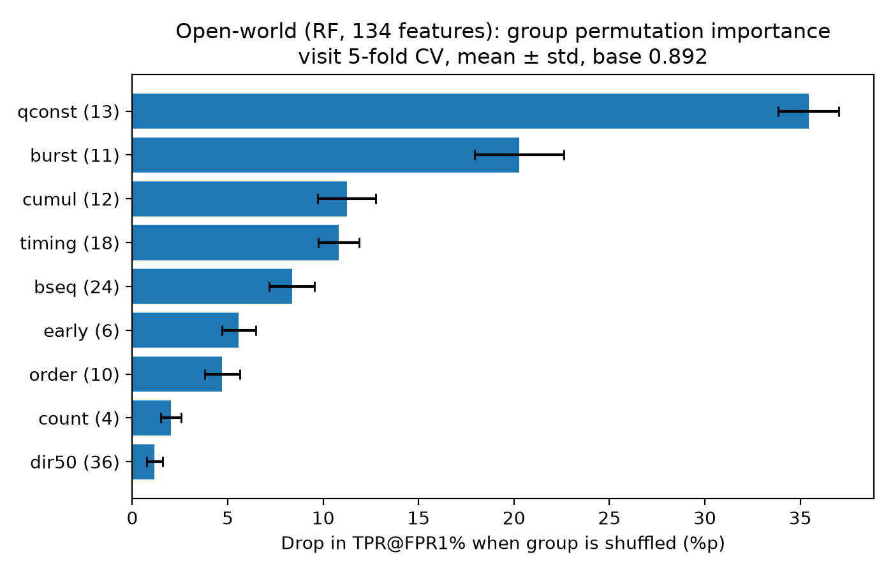
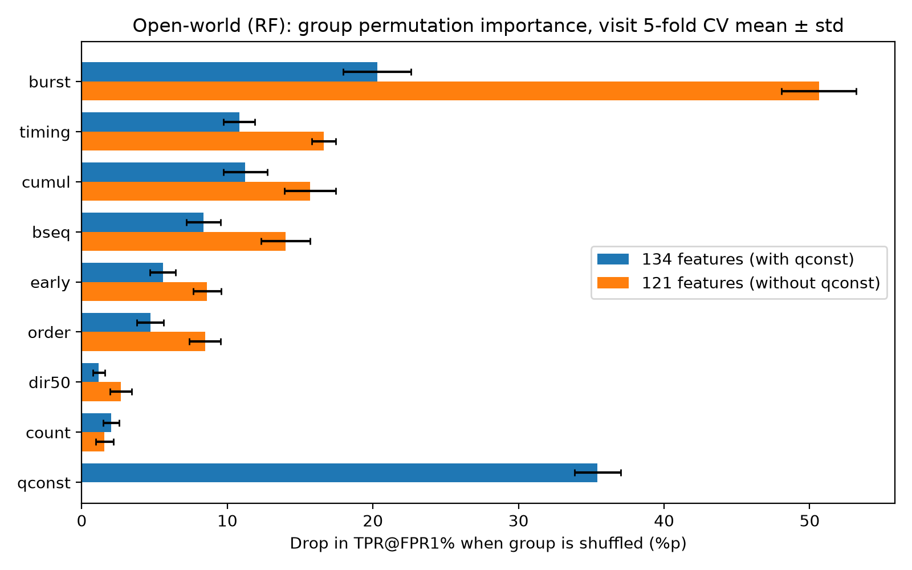

# Feature Importance

## 1. Open-world — 그룹 permutation 중요도

### 1.1 설정

| 항목 | 내용 |
|---|---|
| 피처 | leak 제거(skip14) 피처 중 A팀 후보 134개 (`ow_models.load`, `@all @early @bseq @dir50 @qconst`) |
| 모델 | RF 200그루 (`ow_run.rf`, B 파트 E7~E10과 동일) |
| 라벨 | multi 96클래스 (monitored 95 + unmon -1) |
| 점수 | TPR@FPR≤1% (규칙 B, `ow_models.best_at`) |
| 분할 | visit 기준 train 5-fold. **test는 사용하지 않음** |
| 방법 | fold마다 학습한 모델을 고정하고, 검증 fold에서 한 그룹의 열들을 같은 행 순서로 함께 섞어 점수 하락을 잼. 그룹당 3회 평균, seed 0 |

그룹은 `experiment.groups` 정의를 그대로 썼고, 134개가 9개 그룹에 중복·누락 없이 들어간다.
그룹을 통째로 섞기 때문에, 그룹 안의 피처끼리 상관이 높아도 서로 대신해 주는 효과 없이 그룹 전체의 영향을 잰다.

**permutation과 B 파트 E8(제거 실험)의 차이**

| | E8 제거 실험 | 이 분석 (permutation) |
|---|---|---|
| 방법 | 그룹을 빼고 **다시 학습** | 학습된 모델은 그대로, 검증 데이터에서 그룹 값만 **섞음** |
| 재는 것 | 이 그룹이 없어도 다른 피처가 대신할 수 있는가 | 이 모델이 이 그룹에 얼마나 기대고 있는가 |

재학습하면 다른 피처가 빈자리를 채우므로, 보통 permutation 하락이 제거 실험보다 크게 나온다. 두 결과는 서로 보완 관계로 읽는다.

### 1.2 결과 — 134개

기준 TPR@FPR≤1% = **0.892** (fold 평균; fold별 0.901 / 0.895 / 0.901 / 0.906 / 0.856)

| 순위 | 그룹 | 개수 | 섞었을 때 하락 (%p, 평균 ± sd) |
|---:|---|---:|---:|
| 1 | @qconst | 13 | 35.43 ± 1.57 |
| 2 | @burst | 11 | 20.29 ± 2.34 |
| 3 | @cumul | 12 | 11.24 ± 1.51 |
| 4 | @timing | 18 | 10.82 ± 1.07 |
| 5 | @bseq | 24 | 8.36 ± 1.19 |
| 6 | @early | 6 | 5.57 ± 0.89 |
| 7 | @order | 10 | 4.71 ± 0.92 |
| 8 | @count | 4 | 2.02 ± 0.55 |
| 9 | @dir50 | 36 | 1.17 ± 0.41 |

### 1.3 @qconst를 빼고 다시 본 이유

134개에서는 @qconst(open-world 별칭 `@mid`)가 1위다. 이 그룹은 해석에 주의가 필요해서 빼고도 다시 쟀다.

- **이 분석이 쓴 피처는 앞 14셀을 버린(skip14) 피처다.** 그래서 @qconst라는 이름의 13개는 15–28번째 셀을 가리킨다.
  "mon에서 99.98% 같은 준상수, η² 0.0054, mon/unmon AUC 0.9999"는 **자르기 전** 데이터의 성질이고, 여기에는 해당하지 않는다.
- 자른 뒤 이 13개는 사이트 정보가 가장 많은 그룹이다(train-only η² 평균 0.40, mon/unmon 단일 AUC 0.69, `docs/OPENWORLD.md` 2.3).
- 다만 단독 성능을 보면 식별보다 탐지 기여가 상대적으로 커서(B 파트 E8 관찰 6), mon/unmon 수집 차이가 일부 섞였을 가능성은 배제할 수 없다.

그래서 1위가 다른 그룹의 순위를 왜곡하는지 확인하려고 이 13개를 뺀 121개로 같은 분석을 다시 했다.

> open-world에서는 @qconst를 빼지 않기로 했다(`7cc7bfb`, 별칭 `@mid` — `e1de390`). 121개 분석은 이 결정을 바꾸자는 것이 아니라 **민감도 확인**이다. 팀 공통 결론 문장은 `docs/OPENWORLD.md` 2.3에 있다.

### 1.4 결과 — 121개 (−@qconst)

기준 TPR@FPR≤1% = **0.870** (fold별 0.873 / 0.873 / 0.885 / 0.902 / 0.818). 134개보다 2.2%p 낮고, E8에서 @qconst를 빼고 재학습했을 때(−2.6%p)와 같은 수준이다.

| 그룹 | 개수 | 134개 (%p) | 121개 (%p) | 변화 |
|---|---:|---:|---:|---:|
| @burst | 11 | 20.29 ± 2.34 | **50.63 ± 2.57** | +30.3 |
| @timing | 18 | 10.82 ± 1.07 | 16.62 ± 0.83 | +5.8 |
| @cumul | 12 | 11.24 ± 1.51 | 15.69 ± 1.76 | +4.5 |
| @bseq | 24 | 8.36 ± 1.19 | 13.99 ± 1.67 | +5.6 |
| @early | 6 | 5.57 ± 0.89 | 8.61 ± 0.96 | +3.0 |
| @order | 10 | 4.71 ± 0.92 | 8.46 ± 1.09 | +3.8 |
| @dir50 | 36 | 1.17 ± 0.41 | 2.69 ± 0.74 | +1.5 |
| @count | 4 | 2.02 ± 0.55 | 1.57 ± 0.60 | −0.5 |
| @qconst | 13 | 35.43 ± 1.57 | — | |

### 1.5 해석

1. **나머지 그룹의 순위는 @qconst가 있든 없든 거의 같다.**
   burst > timing·cumul > bseq > early·order > count·dir50. 바뀐 것은 바로 옆끼리 자리를 바꾼 두 쌍뿐이다. cumul·timing은 134개에서 차이가 0.4%p로 표준편차보다 작고, count·dir50은 둘 다 3%p 이하다. 134개에서 본 순위는 @qconst 때문에 생긴 착시가 아니다.

2. **@qconst를 빼면 @burst가 가장 중요하다.**
   134개에서도 @qconst를 빼면 1위이고, 121개에서는 섞었을 때 TPR이 절반 넘게(50.6%p) 떨어진다. 다른 그룹은 +6%p 이하로 늘었는데 burst만 30%p 늘었다. @qconst가 없으면 모델이 burst에 훨씬 더 많이 기대는 것으로 보인다. B 파트 E8에서도 Burst는 빼고 재학습했을 때 크게 떨어진 유일한 그룹(−25.8%p)이라, 두 방법이 같은 결론을 가리킨다.
   (permutation 하락은 더해서 나눠 가지는 값이 아니고 121개는 새로 학습한 모델이므로, @qconst의 35%p가 burst로 "옮겨 갔다"고 계산할 수는 없다.)

3. **@qconst는 모델이 많이 기대지만, 다른 피처로 대신할 수 있다.**
   섞으면 −35.4%p지만, 빼고 재학습하면 −2.2%p(이 분석) / −2.6%p(E8)에 그친다. 학습된 모델은 @qconst를 믿고 판단하도록 만들어져 있어 값이 망가지면 크게 틀리지만, 처음부터 없이 학습하면 burst 등이 그 역할을 대부분 대신한다.

4. **@dir50은 피처 수에 비해 영향이 아주 작다.**
   36개로 가장 큰 그룹인데 다 섞어도 1~3%p이고, E8에서 빼고 재학습해도 같은 수준(−0.7%p)이었다. 같은 앞부분 정보를 @early·@bseq가 더 압축된 형태로 담고 있기 때문으로 보인다(추정).

5. **fold 4는 두 설정 모두 기준 점수가 가장 낮다** (0.856 / 0.818). fold 4 = inst 4·9·14·19라 마지막 방문(inst 19)이 들어 있다. closed-world에서도 모든 모델이 이 fold에서 떨어진다(`docs/CLOSEDWORLD.md` 5절).

### 1.6 보고서에서 다룰 점

- @qconst를 빼고 학습해도 TPR은 2.2%p만 낮고, 그때 모델이 가장 크게 기대는 것은 @burst다. 따라서 이 공격의 핵심 신호는 burst 패턴이고, burst를 흐트러뜨리는 방어가 효과적일 것이라고 해석할 수 있다(추론, 실험으로 확인하지 않음).
- 기준 0.892는 같은 조건인 B 파트 E7 RF의 fold 평균 0.895와 0.35%p 다르다. 다시 돌려도 0.8916이 재현되고, 차이는 fold 표준편차(0.012~0.018) 안이다.
- test 분할로는 평가하지 않았다. 중요도는 모두 train 5-fold CV 기준이다.
- 재현: `python -I -W ignore -X utf8 code/feature_importance_ow.py` → `--drop-qconst` → `--compare` (로그 `logs/feature_importance_ow{,_121}.log`)
