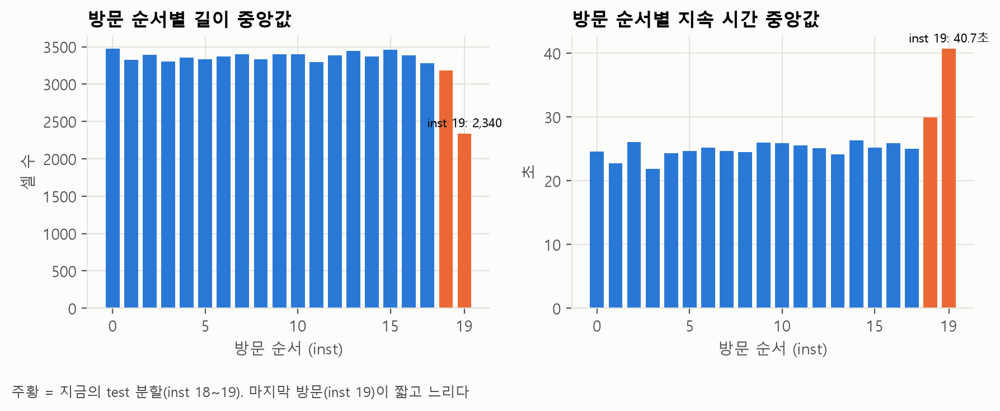

# 점수 정리: 현재 점수의 의미와 최종 점수 산출 방법

현재 나와 있는 점수가 무엇을 뜻하는지, 최종 점수는 어떤 순서로 내는지 정리한 문서다. 실험 과정은 [EXPERIMENTS.md](EXPERIMENTS.md)와 [OPENWORLD.md](OPENWORLD.md)에 있다.

## 요약

- **하이퍼파라미터 튜닝은 아직 하지 않았다.** 모든 모델은 기본 설정이며, 지금까지 바꾼 것은 피처와 전처리뿐이다.
- **최종 점수(test 점수)는 아직 없다.** 현재 점수는 모두 train 내부 교차검증(CV) 점수다.
- **최종 점수는 튜닝을 마친 뒤 test로 한 번만 측정한다.** 보고서에는 이 값을 쓴다.
- **최종 점수는 현재 CV 점수보다 낮을 가능성이 크다.** test에 포함된 마지막 방문(inst 19) 기록이 다른 방문보다 짧고 지속 시간이 길기 때문이다.

---

## 1. 데이터 분할

### mon (감시 대상 95개 사이트)

- 사이트 95개 × URL 10개 × 방문 20회 = **19,000개 기록**
- 방문 번호(inst)는 같은 URL을 방문한 순서이며 0~19다.

| 용도 | 방문 번호 | 개수 |
|---|---|---|
| **train** (학습·모델 선택) | inst 0~17 | 17,100개 |
| **test** (최종 평가) | inst 18~19 | 1,900개 |

모든 URL이 train과 test에 모두 포함된다. 즉 학습한 사이트를 새로 방문한 기록을 얼마나 정확히 분류하는지 측정하는 구조다.

### unmon (감시 대상이 아닌 사이트, open-world에서만 사용)

- **10,000개 기록**이며, 기록마다 사이트가 다르다.
- 시드 0으로 무작위 분할했다. **train 9,000개, test 1,000개**
- test에 포함된 unmon 1,000개는 학습에 사용하지 않은 사이트다.

### CV용 분할

train을 방문 번호 기준으로 5개 fold로 나눈다(inst를 5로 나눈 나머지). 예를 들어 fold 0은 inst 0, 5, 10, 15다. unmon은 train 내부 순서대로 5개 fold로 나눈다.

---

## 2. CV 점수와 test 점수

| | CV 점수 | test 점수 |
|---|---|---|
| 측정 방법 | train을 5개 fold로 나눈 뒤, 4개 fold로 학습하고 나머지 1개 fold로 평가한다. 이를 5회 반복해 평균을 낸다 | 처음부터 분리해 둔 test로 평가한다 |
| 측정 시점 | 피처·설정·모델을 선택하는 동안 반복해서 | 모든 선택이 끝난 뒤 **한 번만** |
| 용도 | 모델·피처 선택 | 보고서에 쓰는 최종 성능 |
| 현재 상태 | 있음 (3·4절의 수치 전부) | **없음** |

### test로 모델을 고르면 안 되는 이유

test 점수를 보면서 피처나 설정을 고르면, 실제로 성능이 좋은 조합보다 **test 1,900개에 우연히 잘 맞는 조합**이 선택될 수 있다. 이 경우 마지막에 보고하는 test 점수가 실제 성능보다 높게 나온다. 선택 과정에 test 정보가 이미 반영되었기 때문이다. 이를 test 누수(test set에 대한 과적합)라고 한다.

### 학습 데이터로 직접 평가하지 않는 이유

학습에 사용한 데이터로 평가하면 모델이 학습 데이터를 기억한 결과까지 정답으로 계산된다. 예를 들어 RF는 학습 데이터에서 정확도가 거의 100%다. CV는 **매번 학습에 사용하지 않은 fold로 평가**하므로 이 문제가 없다.

### CV의 추가 장점

fold마다 점수가 하나씩, 총 5개가 나오므로 점수의 변동 폭(표준편차)을 함께 확인할 수 있다. 이를 기준으로 0.3%p 같은 작은 차이가 실제 차이인지, 우연에 의한 차이인지 판단한다.

### CV 점수의 한계

수십 개 조합 가운데 CV 점수가 가장 높은 것을 골랐기 때문에, 선택된 조합의 CV 점수는 실제보다 다소 높게 나올 수 있다. 최종 성능은 test로 확인한다.

---

## 3. closed-world 점수 (95개 사이트 분류)

**조건**: 후보 피처 131개, 기본 설정(튜닝 전), train 내부 CV, 지표는 정확도

| 모델 | CV 정확도 | fold 간 표준편차 | 비고 |
|---|---|---|---|
| ET | **95.8%** | ±0.2%p | |
| RF | **95.7%** | ±0.4%p | |
| SVM | 95.3% | ±0.5%p | 그룹 가중치(`--gw`) 적용. 미적용 시 94.9% |
| k-NN | 91.9% | ±0.8%p | 그룹 가중치 적용. 미적용 시 90.4% |
| LR | 90.0% | ±0.9%p | 그룹 가중치 미적용. 적용하면 88.1%로 낮아진다 |

> 모두 기본 설정에서 측정한 값이므로 **모델 순위로 해석하면 안 된다.** SVM과 k-NN은 튜닝 후 점수가 더 오를 수 있다.

**고도화 실험(10/31)에서 더 높은 조합이 나왔다** — 같은 131개, 같은 CV 프로토콜:

| 모델 | CV 정확도 |
|---|---|
| **SoftVote (ET + RF + LightGBM)** | **97.2%** ±0.4%p |
| LightGBM (lr 0.05, 400회) | 96.5% ±0.5%p |
| HistGB (lr 0.05, 400회) | 96.2% ±0.4%p |

위 표의 ET·RF는 트리 200그루 기본값이고, 이 표는 300그루 + `max_features`=0.1이다(ET 95.8%, RF 95.7%로 거의 같다). 자세한 내용과 고친 설정 문제는 [EXPERIMENTS.md](EXPERIMENTS.md) "고도화 실험" 절에 있다. **LightGBM이 수업 모델 목록에 없어 사용 가능 여부는 팀 확인이 필요하다.**

### 피처셋별 점수 변화 (RF, CV)

| 피처셋 | 개수 | RF CV 정확도 |
|---|---|---|
| 기본 피처 (상수 피처 3개 제외) | 52 | 87.9% |
| + 앞부분 방향 패턴 (`@early`, `@bseq`) | 82 | 95.5% |
| + 누적합 고정 위치 + 처음 50셀 방향 (**현재 후보**) | 131 | 95.7% |

정확도가 가장 크게 오른 것은 **기록 앞부분의 방향 패턴**을 추가했을 때다(+7.6%p). 이후 변화는 0.2~0.4%p 수준이다.

---

## 4. open-world 점수 (감시 대상 여부 판별)

**조건**: 후보 피처 134개(앞 14셀 제외), RF 기본 설정, 96클래스 방식(사이트 95개 + unmon), train 내부 CV

### 용어

모델은 기록마다 감시 대상일 가능성을 점수로 출력한다. 이 점수가 임계값 이상이면 감시 대상으로 판정한다. 임계값을 낮추면 감시 대상을 더 많이 찾지만 오탐도 늘어나고, 임계값을 높이면 그 반대다.

| 용어 | 의미 |
|---|---|
| TPR | 감시 대상(mon) 중 감시 대상으로 판정한 비율. 높을수록 좋다 |
| FPR | 감시 대상이 아닌 기록(unmon) 중 감시 대상으로 잘못 판정한 비율. 낮을수록 좋다 |
| precision | 감시 대상으로 판정한 기록 중 실제 감시 대상의 비율 |
| ROC-AUC | 임계값 전체 범위에서 두 집단을 얼마나 잘 구분하는지 나타내는 값. 1이면 완벽하게 구분하고, 0.5면 무작위 판정과 같다 |

### 점수

| 지표 | CV 값 |
|---|---|
| ROC-AUC | **0.993** |
| FPR 1% 기준 TPR | **91.4%** (사이트까지 맞힌 비율 90.6%) |
| 같은 기준의 precision | 99.4% |

> **이 점수를 그대로 "공격 성능"으로 쓰면 과대평가다.** 0.993 중 모델이 **사이트를 알아본** 몫은 작다.
> 사이트 식별 정보가 전혀 없는 요약 피처 22개(개수 4 + 시간 18)만으로 ROC-AUC **0.90**이 나오고,
> 감시 대상 사이트를 학습에서 통째로 빼고 평가해도 **0.935**이다(기존 방식 0.989와 차이 0.05).
> 사이트 95개를 5겹으로 나눠 사이트마다 정확히 한 번씩 평가한 결과다.
> 즉 mon 기록과 unmon 기록의 **모집단 차이**가 대부분을 설명한다.
> 실전에서 공격자는 감시 대상을 자기가 고르므로 이 차이는 재현되지 않을 수 있다.
> **보고서에는 0.993과 함께 "사이트 정보 없는 22개로 0.90"이라는 기준선을 같이 쓴다.**
> 원인(사이트 선정 때문인지 수집 조건 때문인지)은 수집 코드가 없어 확정할 수 없다.
> → 자세한 분해와 한계는 [OPENWORLD.md](OPENWORLD.md) 3.10

### FPR 기준별 점수

최종으로 보고할 수치는 팀이 허용할 FPR을 정해야 확정된다.

| FPR 기준 | TPR | 사이트까지 맞힌 비율 | precision |
|---|---|---|---|
| 0.1% | 79.8% | 79.7% | 99.9% |
| 0.5% | 87.7% | 87.2% | 99.7% |
| **1%** | **91.4%** | **90.6%** | **99.4%** |
| 5% | 96.0% | 94.1% | 97.4% |
| 10% | 97.9% | 95.2% | 95.1% |

### precision 해석 시 주의할 점

현재 데이터는 mon이 unmon보다 많다(17,100 : 9,000). 실제 환경에서는 감시 대상이 아닌 사이트가 훨씬 많기 때문에, 같은 모델이라도 unmon 비율이 높아지면 precision이 크게 낮아진다.

| FPR 기준 | 현재 비율 (1.9 : 1) | 1 : 1 | 1 : 10 | 1 : 100 |
|---|---|---|---|---|
| 0.1% | 99.9% | 99.9% | 98.8% | 88.9% |
| 1% | 99.4% | 98.9% | 90.2% | **48.0%** |
| 5% | 97.4% | 95.1% | 66.1% | 16.3% |

unmon이 mon보다 100배 많으면 FPR 1% 기준에서도 감시 대상으로 판정한 기록의 **절반 이상이 오탐**이다. 이 내용은 보고서의 한계에 포함한다.

---

## 5. 최종 점수가 낮게 나올 수 있는 이유

test로 분리한 마지막 방문(inst 18~19), 특히 **inst 19의 기록이 다른 방문과 다르다.**

| | inst 0~17 | inst 18 | inst 19 |
|---|---|---|---|
| 길이 중앙값 | 약 3,300~3,500셀 | 3,184셀 | **2,340셀** |
| 지속 시간 중앙값 | 약 22~26초 | 29.9초 | **40.7초** |



inst 19는 기록이 짧고 지속 시간이 길다. 네트워크 속도가 느렸거나 페이지 로딩이 끝나기 전에 수집이 종료된 것으로 보이지만, 수집 코드가 없어 원인을 확정할 수는 없다. 이 때문에 test 점수는 CV 점수보다 낮게 나올 수 있다.

**이전 측정 예시**: 기본 피처 55개를 사용한 RF는 CV 약 88%, test 약 73%였다.

### 팀 결정 사항: test 분할 방식

| 선택지 | 장점 | 단점 |
|---|---|---|
| (a) 현재처럼 inst 18~19를 test로 사용 | 수집 환경이 달라졌을 때의 성능까지 평가할 수 있다 | 점수가 낮게 나온다 |
| (b) 방문 번호와 관계없이 고르게 추출해 다시 분할 | 일반적인 조건에서의 성능을 보여 준다. CV와 비슷한 점수가 나올 것으로 예상된다 | 분할을 다시 해야 한다 |

어느 방식을 택하든 **튜닝 전에 결정**하고, 선택 이유를 보고서에 적는다.

---

## 6. 진행 순서

1. **팀 결정**: test 분할 방식(5절), open-world FPR 기준(4절)
2. **튜닝** (7단계, 모델 담당): CV로 모델 설정값을 정하고 최종 모델을 선택한다. 이 단계에서도 test는 사용하지 않는다.
3. **최종 평가** (8단계): 선택한 모델로 test를 **한 번만** 평가한다. open-world는 CV에서 정한 임계값을 그대로 적용한다.
4. 보고서에는 test 점수를 쓰고, CV 점수는 모델 선택에 사용한 점수로 함께 적는다.

### 점수 재현 명령

```
python -I -W ignore -X utf8 code/experiment.py @all -@const @early @bseq @cumulabs @dir50 -m rf              # closed-world CV
python -I -W ignore -X utf8 code/experiment.py @all -@const @early @bseq @cumulabs @dir50 -m knn --gw        # k-NN (그룹 가중치)
python -I -W ignore -X utf8 code/openworld.py @all @early @bseq @dir50 @qconst --skip 14 --mode multi        # open-world CV
```

`--test`를 붙이면 test로 평가한다. **최종 평가에서 한 번만 사용한다.**
