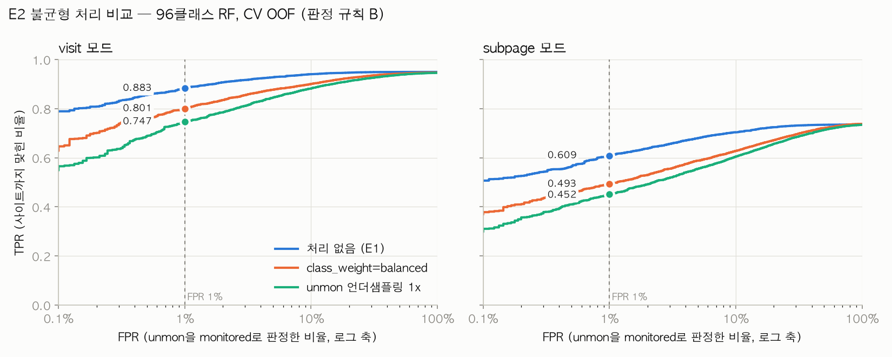
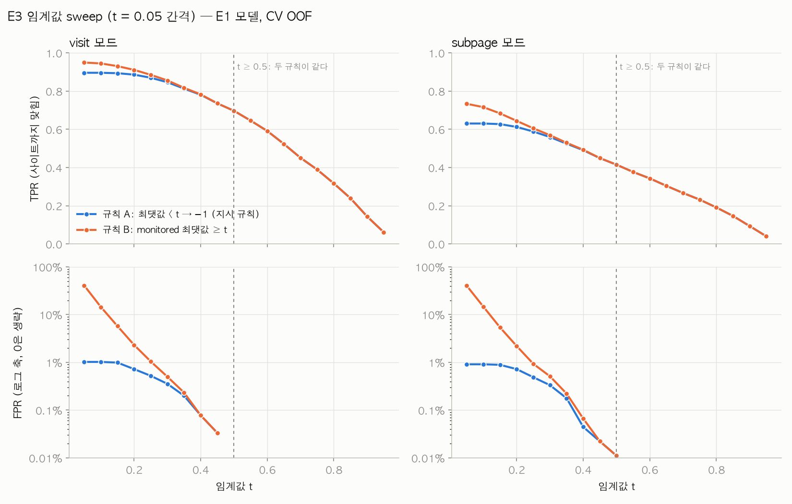
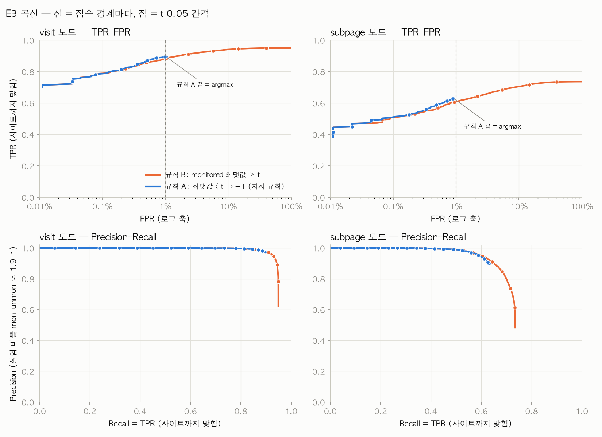
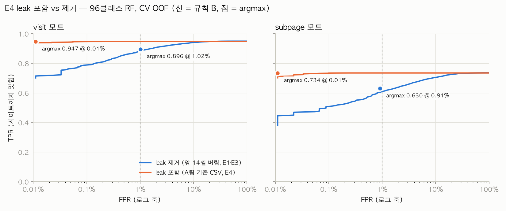
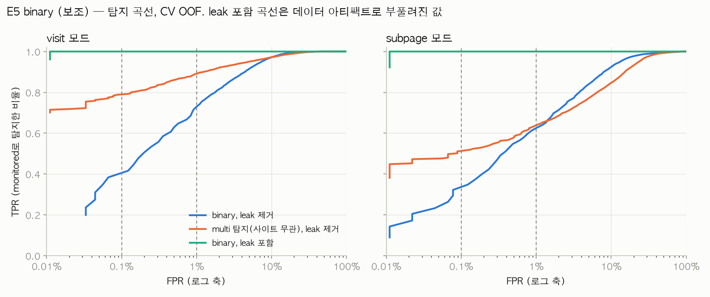
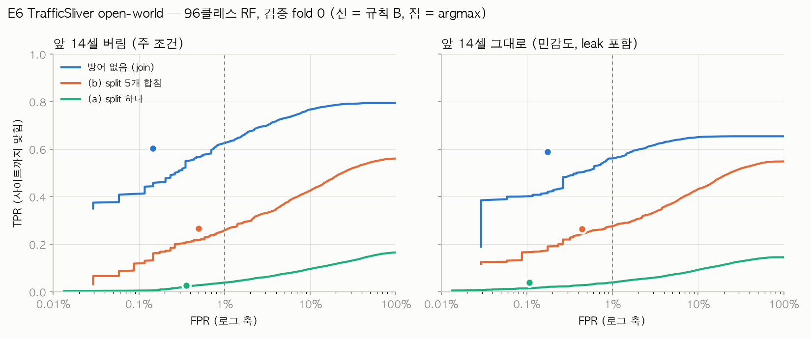
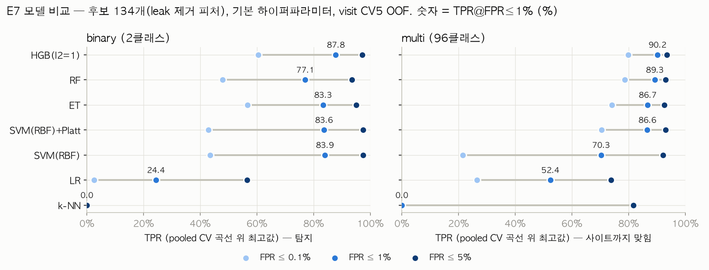
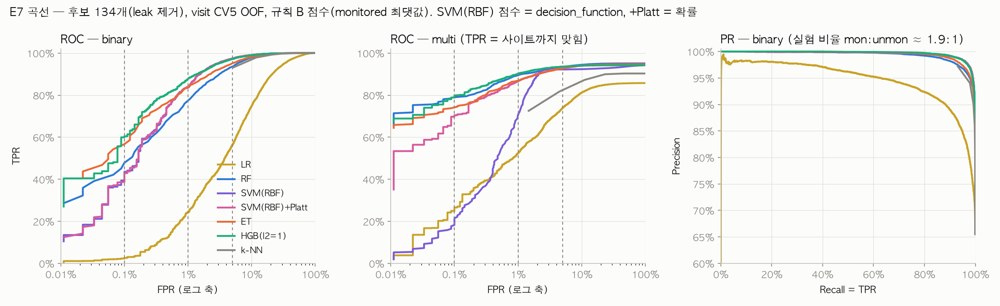

# open-world 실험 리포트 (B 파트)

이 문서의 모든 수치는 아래 0절의 leakage 처리를 거친 데이터에서 나온 것이다. 처리를 하지 않은 조건의 수치는 비교용(E4, E6 민감도)으로만 쓰며, 표에 따로 표시한다.

## 0. 데이터 누수(leakage) 처리 — 먼저 읽을 것

> **요약**: 본 데이터(pkl)와 extra credit(TrafficSliver)의 **모든 기록에서 앞 14셀을 버리고** 피처를 계산한다.
> 버린다는 것은 피처를 계산할 때 기록의 1~14번째 셀을 건너뛰고 15번째 셀부터 센다는 뜻이다(`t[14:]`).
> 원본 파일과 A팀 산출물은 바꾸지 않는다.
> pkl은 A팀이 이미 처리한 피처를 그대로 쓰고, TrafficSliver는 이번에 처리하지 않으면 누수가 남는다는 것을 확인해 같은 방식으로 처리했다.

### 0.1 누수 패턴

조교 공지: monitored trace의 99.98%는 처음 14셀(인덱스 0~13)의 방향 패턴이 같고, unmonitored에서는 10,000개 중 1개뿐이다.
"인덱스 7번 셀이 outgoing이면 monitored"라는 규칙 하나로 open-world 이진 분류가 99.99%가 된다.
웹사이트 내용이 아니라 수집 과정에서 생긴 흔적이므로, 이 신호를 쓴 점수는 실제 공격 성능이 아니다.

### 0.2 본 데이터(pkl): A팀 처리 승계

| 항목 | 내용 | 근거 |
|---|---|---|
| 처리 방식 | 앞 14셀을 **잘라낸 뒤** 피처 376개를 전부 다시 계산 (특정 피처만 빼는 방식이 아니다) | `code/features_ow.py` (`t[K:]`, K=14), 커밋 `ac64bc2` (2026-10-16) |
| 적용 시점 | 피처 추출 단계. mon·unmon 모두 동일하게 적용 | 같은 파일 |
| 시간 축 | 버린 뒤에도 시각은 원래 값 그대로 (0으로 다시 맞추지 않음) | 같은 파일 docstring |
| K=14 근거 | mon은 1~14번째 셀이 사실상 전부 같고(사이트 정보 없음), 버려도 closed-world 정확도 손실 없음 (95.56% → 95.67%) | `docs/OPENWORLD.md` 2.2–2.4 |
| 산출물 | **leak 포함**: `features/features_*.csv` (55+150+171) / **leak 제거**: `features/ow_skip14_*.csv` (376, 이름·순서 동일) | 둘 다 커밋됨 → E4 가능 |

커밋된 CSV로 다시 잰 값 (`code/ow_leak_check.py`, `logs/ow_leak_check.log`):

| 피처 | mon 앞 14셀 최빈 패턴 비율 | "idx7 outgoing → mon" acc / TPR / FPR |
|---|---|---|
| leak 포함 (`features_extra2_*`) | **99.98%** (`--+-+-++------`) | **0.9999** / 0.9999 / 0.0002 |
| leak 제거 (`ow_skip14_*`) | 3.65% | 0.579 / 0.435 / 0.147 (규칙이 더는 통하지 않음) |

leak 포함 수치가 조교 공지(99.98%, unmon 1만 개 중 1개)와 정확히 일치한다.

### 0.3 extra credit(TrafficSliver): 이번에 확인하고 같은 방식으로 처리

A팀은 split만 검사해 "자를 필요 없다"고 판단했다(`docs/EXTRA_CREDIT.md` 4.5, 단일 피처 AUC 최대 0.555).
원본 `mon.zip`·`unmon.zip`의 파일 228,000개 전부에서 앞 14셀 방향을 직접 읽어 다시 확인했다.

| 데이터 | mon 최빈 패턴 | unmon 최빈 패턴 | "idx7 outgoing → mon" acc / TPR / FPR |
|---|---|---|---|
| **join (방어 없음)** | `--+-+-++------` 67.0% | `--+-+-+-+-++--` 23.3% | **0.9940** / 0.9977 / 0.0097 |
| split 0~4 전체 (방어 있음) | `--------------` 68.5% | `--------------` 67.5% | 0.515 / 0.281 / 0.245 |
| split_0 ~ split_4 각각 | (전체와 같은 모양) | | 0.512 ~ 0.520 |
| └ split 중 앞 7셀이 `--+-+-+`로 시작하는 것 (mon 3.4%, unmon 4.5%) | `--+-+-++------` 87.2% | `--+-+-+-+-++--` 23.8% | **0.9952** / 1.000 / 0.0086 |

- **join에는 pkl과 같은 누수가 있다.** 따라서 A팀의 extra credit "방어 없음" open-world 수치(binary ROC-AUC 0.9977, TPR@FPR1% 97.1%)는 누수로 부풀려진 값이다. 이 문서는 그 값을 기준선으로 쓰지 않는다.
- **split은 전체로는 누수가 없지만 일부 조각에 남아 있다.** 방문마다 최대 1개의 split이 join의 시작 구간을 그대로 받으며, 그 부분집합에서는 규칙이 99.5% 맞는다.
- **처리 (결정: 2026-11-26)**: join과 split **모두** 앞 14셀을 일괄로 버린다. pkl과 같은 방식이다.
  누수가 있는 split은 흔적이 사라지고, 나머지 split은 셀 약 2.6%(중앙값 530셀 중 14셀)를 잃는다.
  E6에서는 버리지 않은 조건도 민감도 행으로 함께 보고한다.
- closed-world(mon끼리 비교)는 이 누수의 영향을 거의 받지 않는다. mon/unmon을 가르는 흔적이기 때문이다. A팀의 extra credit closed-world 수치는 그대로 유효하다.

### 0.4 이 리포트가 세운 가정

| 항목 | 가정 | 근거 |
|---|---|---|
| monitored 클래스 수 | **95** (사이트 0~94). open-world multi는 95 + unmon(−1) = **96클래스** | pkl: `features_mon.csv`의 `site` 고유값 95, URL 950, 사이트당 200·URL당 20. TrafficSliver: `mon.zip` 파일명 고유 사이트 95, 방문 0~199. 코드는 하드코딩하지 않고 데이터에서 센다 |
| "100개 사이트, 101 클래스" | 이 데이터와 맞지 않으므로 쓰지 않는다 | 위와 같음 |
| pkl 라벨 | `site = url // 10`, subpage = `url` (사이트당 10개), 반복 관측 = `inst` (0~19) | `code/load_data.py` |
| TrafficSliver 파일명 | mon `{사이트}-{방문}_split_{0-4}.cell` / `_join.cell`, unmon `{번호}_split_{k}.cell` / `_join.cell`. 한 줄 = `시각\t방향(±1)\t크기(±512)` | zip 파일명 전수 파싱(실패 0개), 실제 파일 열어 확인 |
| TrafficSliver subpage | 파일명에 subpage 정보가 없다. **방문(group) 단위 분할만** 한다 | 파일명 구조 |
| TrafficSliver split 시각 | **split 파일마다 시각이 0부터 다시 시작한다**(100%). join 시계 기준 offset이 원본에 없다. E6(b) merge 기준은 6단계에서 정해 명시한다 | `logs/ow_leak_check.log` |
| 빈 split | 뺀다 (mon 7,962개, unmon 9,953개) | A팀과 같음 |

재현: `python -I -X utf8 code/ow_leak_check.py "<extra credit 폴더>/mon.zip" "<extra credit 폴더>/unmon.zip" > logs/ow_leak_check.log` (약 20초, zip은 풀지 않는다)

## 1. split 전략 (2단계)

> C팀이 커밋한 공유 split 파일은 없었다. C팀 노트북(`code/closed_world_experiments.ipynb`)은 옛 분할(`inst < 18`)을 쓴다.
> 결정(2026-11-26): **test holdout과 visit 모드 CV는 A팀 규칙을 그대로 파일로 옮기고, subpage 모드만 `random_state=42`로 새로 만든다.**
> A팀의 기존 open-world 수치와 행 단위로 같은 분할이라 바로 비교할 수 있다.

생성: `python -I -W ignore -X utf8 code/ow_splits.py "<extra credit 폴더>/mon.zip" "<extra credit 폴더>/unmon.zip" > logs/ow_splits.log` (약 10초, 다시 돌려도 같은 파일이 나온다)

### 1.1 파일

| 파일 | 행 | 열 | 대응 |
|---|---|---|---|
| `splits/pkl_mon.csv` | 19,000 | `row, site, url, inst, is_test, fold_visit, fold_subpage` | `row` = `features/*_mon.csv`의 행 번호(0부터) |
| `splits/pkl_unmon.csv` | 10,000 | `row, is_test, fold` | `row` = `features/*_unmon.csv`의 행 번호 |
| `splits/sliver_mon.csv` | 19,000 방문 | `group, site, inst, n_nonempty_split, is_test, fold` | 피처 행의 `group`으로 매칭 (split 5개 + join이 같은 group) |
| `splits/sliver_unmon.csv` | 19,000 방문 | `group, id, n_nonempty_split, is_test, fold` | 같음 |

test 행의 fold는 −1이다. 축소판(`mon_25`, `unmon_5000` 등)은 같은 파일의 부분집합이라(`site < N`, `id < N`) 이 표를 걸러서 쓴다.

### 1.2 규칙

| | test holdout | CV fold | 출처 |
|---|---|---|---|
| pkl mon | URL마다 방문 2개(`ld.mon_is_test`), 1,900개 | **visit**: `inst % 5` / **subpage**: URL 단위 `StratifiedGroupKFold(5, shuffle=True, random_state=42)` | visit·test = A팀, subpage = 신규 |
| pkl unmon | `default_rng(0).permutation`의 앞 1,000개 | 섞은 순서에서 train i번째 → `i % 5`. **두 모드에 같은 값** | A팀 `openworld.split` |
| sliver mon | `ld.sliver_is_test(group)`, 1,900 방문(사이트당 18~23) | train 방문에 `GroupKFold(5)` | A팀 `verify_sliver_sets.py` |
| sliver unmon | `ld.sliver_is_test(group + 10**7)`, 1,901 방문 | 같은 방식으로 따로 | test = A팀 `openworld_sliver.py`, fold = 신규 |

- **visit 모드**("랜덤 split"에 해당): 같은 URL(subpage)의 다른 방문이 train과 검증 양쪽에 들어간다. 각 URL이 5개 fold 전부에 나온다.
- **subpage 모드**: 한 URL의 train 방문 18개가 전부 같은 fold에 들어간다. 사이트마다 fold당 URL이 **정확히 2개**라 클래스 균형이 유지된다(fold당 3,420행).
- 두 모드의 차이는 **mon을 묶는 방식 하나뿐이다.** unmon fold는 같다(unmon은 기록마다 다른 사이트라 묶을 단위가 없다).
- `code/ow_splits.py`가 A팀 `openworld.split(skip=14)`의 train·test·fold와 행 단위로 같은지 assert로 대조한다. sliver test 방문 수(train 34,199 / test 3,801)도 A팀 `logs/openworld_sliver_v2.log`와 같다.

### 1.3 가정과 한계

- **subpage 모드는 CV 비교 전용이다.** test holdout이 URL마다 방문 2개라 test의 URL은 전부 train에도 있다. 최종 test 1회 평가는 visit 모드 기준으로 하고, subpage 모드와의 차이는 CV로 보고한다.
- **TrafficSliver는 방문(group) 단위 분할만 있다.** 파일명에 subpage 정보가 없다.
- `random_state=42`는 새로 만든 subpage fold에만 쓴다. A팀 규칙 부분(unmon 시드 0, `inst % 5`, 정수 해시)은 기존 수치와 비교하려고 그대로 둔다.
- 불균형: pkl train에서 unmon 9,000개 대 mon 사이트 하나 180개로 **50배**다(E2에서 다룬다).

## 2. 평가 지표 (4단계 정의, 모든 실험 공통)

코드: `code/ow_metrics.py`, 단위 테스트: `tests/test_ow_metrics.py` (19개, `python -I -m unittest discover -s tests -v`)

| 실제 \ 예측 | 정답 사이트 | 다른 monitored 사이트 | −1 |
|---|---|---|---|
| monitored | **TP** | **wrong_site** (TP 아님, 따로 셈) | FN |
| unmonitored | FP | FP | TN |

- `TPR = TP / mon 수`, `FPR = FP / unmon 수`, `precision = TP / (TP + wrong_site + FP)` (monitored로 판정한 것 전체가 분모)
- `recall`: 결과 CSV 컬럼 고정 때문에 둔다. positive를 "사이트까지 맞힌 것"으로 정의하면 TPR과 같은 값이다.
- `macro_f1`: −1을 포함한 (N+1)개 클래스의 macro F1 (보조).
- notes에 함께 적는 것: `det_TPR = (TP + wrong_site) / mon 수` (사이트는 틀려도 monitored로는 잡은 비율), wrong_site 개수, FN·FP 개수, fold 간 표준편차.
- sklearn `accuracy_score`는 쓰지 않는다. unmon이 많으면 사이트를 하나도 못 맞혀도 높게 나온다(테스트 `test_accuracy_score_is_misleading`: accuracy 0.97, TPR 0).
- confusion matrix는 `results/confusion/<exp_id>.csv`에 저장한다(첫 행·열 = −1).

**E7부터 결과 CSV 뒤에 추가한 컬럼** (기존 14개 컬럼은 이름·순서·값 그대로. E1~E6 행은 빈 값. 코드 `ow_run.extra_metrics`, 테스트 `TestExtraColumns`)

| 컬럼 | 정의 |
|---|---|
| `accuracy` | 전체 샘플 중 라벨(−1 포함)이 정확히 맞은 비율. 과제 요구라 기록만 한다¹ |
| `f1` | `2·precision·TPR / (precision + TPR)`. TP 정의는 위와 같다(사이트까지 맞힘). binary는 보통의 F1 |
| `roc_auc`, `pr_auc` | 탐지 점수(multi = monitored 확률 최댓값, binary = P(mon))로 "mon인가"를 가른 ROC-AUC·average precision. 임계값과 무관해 한 모델의 4개 행이 같은 값이다 |
| `det_TPR` | `(TP + wrong_site) / mon 수`. 지금까지 notes에 적던 값을 컬럼으로 뺐다 |
| `site_id_rate` | **사이트 정확 식별률** = `TP / (TP + wrong_site)`: monitored로 잡은 mon 중 사이트까지 맞힌 비율 (multi만) |

¹ **accuracy는 해석의 근거로 쓰지 않는다.** unmon(전체의 34%)을 −1로 맞히는 것만으로 올라가서, 예를 들어 E7 RF multi는 accuracy 0.929인데 사이트까지 맞힌 TPR은 0.896이다. 실제 비율(unmon ≫ mon)에서는 사이트를 하나도 못 맞혀도 accuracy가 0.99를 넘을 수 있다(`test_accuracy_score_is_misleading`).

## 3. 실험 결과

결과 원본: `results/openworld_results.csv` (고정 컬럼). 별도 표기가 없으면 pkl, 앞 14셀 버린 피처, train 내부 5-fold CV의 out-of-fold 예측이다. test는 아직 쓰지 않았다.

### E1 — 베이스라인 (multi, 96클래스)

| 설정 | 값 |
|---|---|
| 클래스 | monitored 95개(데이터에서 셈) + unmon 전체를 −1 한 클래스 = 96 |
| 피처 | 376개 전체 (`ow_skip14`) |
| 모델 | `RandomForestClassifier(n_estimators=200, random_state=42)` — A팀 설정에서 시드만 42 |
| 불균형 처리 | 없음 (train에서 unmon 9,000 : mon 사이트 하나 180 = 50배) |
| 판정 | argmax (임계값 없음) |
| 재현 | `python -I -W ignore -X utf8 code/ow_run.py e1 > logs/ow_e1.log` (약 2분, M3) |

| split_mode | TPR | FPR | precision | macro F1 | det_TPR | wrong_site | FN | FP |
|---|---|---|---|---|---|---|---|---|
| visit | **0.8958** (±0.019) | 0.0102 (±0.001) | 0.9731 | 0.9315 | 0.9153 | 332 (1.9%) | 1,449 | 92 |
| subpage | **0.6302** (±0.029) | 0.0091 (±0.002) | 0.8974 | 0.7190 | 0.6975 | 1,150 (6.7%) | 5,173 | 82 |
| 차이 | **−0.266** | −0.001 | −0.076 | −0.213 | −0.218 | ×3.5 | ×3.6 | |

(± = fold 5개의 표준편차. mon 17,100 / unmon 9,000)

**파이프라인 검증**
- subset(mon 사이트 25개 / unmon 5,000개, 26클래스)에서 먼저 돌렸다: visit TPR 0.898, subpage 0.600. 전체와 같은 방향이다(`logs/ow_e1_subset.log`, CSV의 `pkl_m25_u5000` 행).
- E1-visit의 OOF 확률을 A팀 `openworld.report()`에 넣으면 ROC-AUC 0.9913, FPR≤1%에서 TPR_site 0.882다. A팀 134개 피처 결과(0.9926, 0.889, `docs/TEST_SPLIT.md`)와 0.7%p 안에서 맞는다. 피처 수(376 vs 134) 말고는 같은 조건이다.

**해석**
- **같은 subpage의 반복 관측이 train과 검증에 섞이면 TPR이 26.6%p 부풀려진다.** visit 모드는 "학습 때 본 페이지를 다시 방문"하는 상황을, subpage 모드는 "같은 사이트의 처음 보는 페이지"를 맞히는 상황을 잰다.
- FPR은 두 모드에서 같다(0.010 vs 0.009). unmon fold가 같고 바뀐 것은 mon을 묶는 방식뿐이기 때문이다(1.2절). 따라서 차이는 전부 mon 쪽에서 나온다.
- 떨어진 TPR의 대부분은 **FN**(mon → −1, 1,449 → 5,173)이다. wrong_site는 332 → 1,150으로 늘지만 FN보다 훨씬 작다. 처음 보는 페이지는 다른 monitored 사이트로 헷갈리기보다 **"아는 사이트가 아니다"로 판정된다.** 모델이 사이트보다 페이지 단위의 지문을 배웠다는 뜻이다.
- 어느 쪽이 현실적인지는 위협 모델에 달렸다. 감시 대상 페이지가 정해져 있으면 visit, 사이트 전체를 감시하면 subpage다. 과제와 A팀·C팀 수치는 visit 기준이므로 **주 지표는 visit으로 보고하고, subpage는 일반화 한계로 함께 보고한다.**
- 불균형(50배)의 흔적: argmax 판정에서 FN(1,449)이 FP(92)의 16배다. 모호한 mon 기록이 수가 많은 −1 쪽으로 쏠린다. E2에서 다룬다.

### E2 — 불균형 처리 비교

E1과 같은 split·RF·피처 376개에서 **불균형 처리만** 바꿨다. 재현: `python -I -W ignore -X utf8 code/ow_run.py e2 > logs/ow_e2.log` (약 6분), 그림만: `... ow_run.py e2plot`.

| 방법 | 내용 |
|---|---|
| 처리 없음 | E1 그대로 |
| `class_weight='balanced'` | RF 클래스 가중치. unmon 한 클래스의 가중치가 사이트 하나보다 약 50배 작아진다 |
| unmon 언더샘플링 1x | **학습 fold에서만** unmon을 "monitored 사이트 하나의 평균 크기"(144개)로 무작위로 줄인다(시드 42 + fold). 검증 fold는 전부 쓴다. 보조로 5x·10x도 쟀다 |
| 임계값 조정 | 처리 없는 모델(E1의 OOF 확률)에 FPR ≤ 1%가 되는 임계값을 적용한다. 재학습은 없다 |

**비교 기준 (실험 전에 정함)**
- 방법마다 판정점이 다르므로(balanced는 TPR과 FPR을 함께 올린다) argmax 값만으로는 비교할 수 없다. **FPR ≤ 1%로 판정점을 맞추고 TPR(사이트까지 맞힘)로 비교한다.** 1%는 A팀 임계값 표와 같은 기준이다.
- 임계값은 **평가할 fold를 뺀 나머지 4개 fold의 unmon OOF 점수**로 정하고 그 fold에 적용한다(`nested_fpr_pred`). 평가 데이터를 보고 임계값을 고르지 않는다.
- 판정 규칙은 **규칙 B**(monitored 확률 최댓값 ≥ t → 그 사이트, 아니면 −1)다. 지시된 규칙 A(전체 확률 최댓값 < t → −1)는 t를 올릴수록 −1 판정만 늘어나서, argmax보다 monitored를 더 잡는 쪽(불균형 보정 방향)으로는 움직일 수 없다. 두 규칙은 t ≥ 0.5에서 같다. 규칙 A로 다시 잰 결과는 아래 "강건성"에 있다.
- 승자: visit 모드 TPR@FPR≤1%가 가장 높은 방법. 차이가 fold 표준편차 안이면 단순한 쪽(처리 없음).

**결과 (visit 모드, CV OOF, mon 17,100 / unmon 9,000)**

| 방법 | argmax TPR | argmax FPR | argmax precision | **TPR @FPR≤1%** | precision @FPR≤1% | wrong_site @FPR≤1% |
|---|---|---|---|---|---|---|
| 처리 없음 → **임계값 조정** | 0.8958 | 0.0102 | 0.9731 | **0.8826** (±0.023) | 0.9856 | 131 |
| class_weight=balanced | 0.9464 | 0.4253 | 0.7746 | 0.7991 (±0.021) | 0.9919 | 20 |
| 언더샘플링 1x | 0.9457 | 0.6954 | 0.6926 | 0.7443 (±0.020) | 0.9918 | 14 |
| (보조) 언더샘플링 5x | 0.9433 | 0.2051 | 0.8584 | 0.8103 | 0.9912 | 33 |
| (보조) 언더샘플링 10x | 0.9385 | 0.0999 | 0.9092 | 0.8391 | 0.9901 | 56 |

**subpage 모드**: TPR@FPR≤1% = 임계값 조정 **0.6069** / balanced 0.4903 / 언더샘플링 1x 0.4509 / 5x 0.5120 / 10x 0.5535. 순위가 visit과 같다.

(그림의 곡선과 FPR 1% 점은 5개 fold를 합친 pooled 값이라 위 표의 fold별 임계값 값과 소수 셋째 자리에서 조금 다르다.)

**결정: E2 승자 = 불균형 처리 없음 + 임계값 조정.** 2등(balanced)보다 TPR@FPR≤1%가 8.4%p 높다(fold 표준편차 약 2%p의 4배). E3는 E1 모델의 OOF 확률을 쓴다.

**해석**
- balanced와 언더샘플링은 argmax에서 TPR을 0.896 → 0.946으로 올리지만 **FPR이 1% → 43%(balanced), 70%(1x)로 폭증한다.** 판정점을 움직였을 뿐 더 나은 모델이 된 것이 아니다. 같은 FPR에서 비교하면 셋 다 처리 없는 모델보다 나쁘다.
- 학습에 쓰는 unmon이 많을수록 좋아진다: 1x 0.744 < 5x 0.810 < 10x 0.839 < 전부(약 50x) 0.883. **unmon은 한 클래스지만 서로 다른 사이트 9,000개다.** 줄이거나 가중치를 낮추면 "감시 대상이 아닌 것"의 다양성을 덜 배워서 처음 보는 unmon을 monitored로 착각하기 쉬워진다.
- E1의 "FN이 FP의 16배"는 고쳐야 할 결함이 아니라 판정점의 문제다. 원하는 FPR에 맞춰 임계값을 정하면 되고, 재학습이 필요 없다.

**강건성: 규칙 A로 다시 재도 순위가 같다** (pooled, 임계값 0.0025 간격)

| 방법 | visit 규칙 A | visit 규칙 B | subpage 규칙 A | subpage 규칙 B |
|---|---|---|---|---|
| 처리 없음 | **0.8955** | 0.8821 | **0.6302** | 0.6051 |
| balanced | 0.7992 | 0.7992 | 0.4908 | 0.4908 |
| 언더샘플링 1x | 0.7440 | 0.7440 | 0.4500 | 0.4500 |
| 언더샘플링 10x | 0.8430 | 0.8378 | 0.5641 | 0.5502 |

- 처리 없는 모델에서는 **FPR ≤ 1% 구간에서 규칙 A가 B보다 1.3~2.5%p 높다.** unmon 클래스 확률이 판정에 추가 정보를 준다는 뜻이다. 대신 규칙 A는 FPR을 argmax 지점(약 1%) 위로 올릴 수 없다.
- balanced·언더샘플링은 FPR 1%를 맞추려면 임계값이 0.5 이상이라 두 규칙이 같다.
- subset(mon 25 / unmon 5,000)에서도 순위가 같았다(`logs/ow_e2_subset.log`).

### E3 — 임계값 sweep (B 파트 핵심 산출물)

E2 승자(불균형 처리 없음 = E1 모델)의 OOF 확률로, 재학습 없이 판정 임계값만 바꿨다. 재현: `python -I -W ignore -X utf8 code/ow_run.py e3 > logs/ow_e3.log` (약 1분).

- **판정 규칙 두 개를 함께 그린다** (결정: 2026-11-26).
  - **규칙 A** (지시 규칙): `predict_proba` 최댓값 < t → −1. t를 올릴수록 −1 판정만 늘어 곡선이 argmax 지점(FPR 약 1%)에서 끝난다.
  - **규칙 B**: monitored 확률 최댓값 ≥ t → 그 사이트. FPR 100%까지 전 구간을 덮는다(A팀 `openworld.scores`와 같은 점수).
  - **t ≥ 0.5에서 두 규칙은 같다.**
- t = 0.05 ~ 0.95, 0.05 간격 × 규칙 2개 × 모드 2개 = 76행을 결과 CSV에 넣었다(`exp_id = E3-<규칙>-<모드>-t<t>`). 곡선은 점수 경계마다 촘촘히 계산했고, 0.05 간격 점과 그리드 판정(`ow_metrics`)이 정확히 같은지 assert로 대조했다.
- 모든 값은 train CV OOF를 합친 pooled 값이다. 임계값을 "고르지" 않고 각 t에서 그대로 재므로 누수 문제는 없다. 다만 표의 "FPR 목표별 최고 TPR"은 같은 데이터에서 고른 점이라 약간 낙관적이다. 다른 fold로 고른 값(E2)은 visit 규칙 B 0.8826 vs 여기 0.8821로 차이가 없다.

**임계값별 결과 (visit 모드, 일부. 전체는 결과 CSV·`logs/ow_e3.log`)**

| t | 규칙 A TPR | 규칙 A FPR | 규칙 A precision | 규칙 B TPR | 규칙 B FPR | 규칙 B precision |
|---|---|---|---|---|---|---|
| 0.05 | 0.8958 | 1.02% | 0.973 | 0.9495 | 40.67% | 0.783 |
| 0.10 | 0.8958 | 1.02% | 0.973 | 0.9448 | 14.46% | 0.892 |
| 0.20 | 0.8861 | 0.72% | 0.982 | 0.9110 | 2.31% | 0.972 |
| 0.25 | 0.8698 | 0.52% | 0.988 | 0.8849 | 1.04% | 0.985 |
| 0.30 | 0.8464 | 0.36% | 0.993 | 0.8558 | 0.50% | 0.992 |
| 0.40 | 0.7806 | 0.08% | 0.998 | 0.7827 | 0.08% | 0.998 |
| 0.50 | 0.6968 | 0.00% | 0.999 | (같음) | | |
| 0.70 | 0.4506 | 0.00% | 1.000 | (같음) | | |
| 0.90 | 0.1439 | 0.00% | 1.000 | (같음) | | |

**FPR 목표별 최고 TPR (사이트까지 맞힘)**

| FPR 목표 | visit 규칙 A | visit 규칙 B | subpage 규칙 A | subpage 규칙 B |
|---|---|---|---|---|
| ≤ 0.1% | 0.785 | 0.787 | 0.510 | 0.506 |
| ≤ 0.5% | **0.868** | 0.856 | **0.588** | 0.562 |
| ≤ 1% | **0.896** | 0.882 | **0.630** | 0.605 |
| ≤ 2% | (도달 불가) | 0.906 | (도달 불가) | 0.637 |
| ≤ 5% | (도달 불가) | 0.927 | (도달 불가) | 0.680 |

**현실 비율에서의 precision** — 실험은 mon:unmon ≈ 1.9:1이라 precision이 높게 나온다. 같은 TPR·FPR·wrong_site 비율로 unmon을 k배로 바꾸면 `precision = TPR / (TPR + wrong_site_rate + k·FPR)`이다.

| visit, 판정점 | TPR | FPR | 1 : 1 | 1 : 10 | 1 : 100 |
|---|---|---|---|---|---|
| FPR ≤ 0.1% (t ≈ 0.40) | 0.785 | 0.09% | 0.997 | 0.987 | **0.897** |
| FPR ≤ 1% (규칙 A, t ≈ 0.13) | 0.896 | 1.00% | 0.969 | 0.883 | **0.468** |
| FPR ≤ 5% (규칙 B, t ≈ 0.16) | 0.927 | 4.71% | 0.931 | 0.653 | **0.164** |

(subpage: FPR ≤ 0.1%에서 1:100 precision 0.83~0.84, FPR ≤ 1%에서 0.39)

**해석**
- **임계값 하나로 TPR과 FPR을 원하는 만큼 맞바꿀 수 있다.** 0.05 간격 sweep에서 visit 모드는 TPR 0.95 / FPR 41%(t=0.05, 규칙 B)부터 TPR 0.70 / FPR 0%(t=0.5)까지 이어진다. 확률 기반으로 판정하므로 특정 패킷 위치 같은 규칙을 쓰지 않는다.
- **규칙 A는 FPR 0.5~1% 구간에서 B보다 1.2~2.5%p 높다.** argmax는 "monitored 중 최고"뿐 아니라 "unmon보다 높은가"까지 보므로 정보가 하나 더 들어간다. FPR 0.1% 이하에서는 두 규칙이 거의 같고, FPR 1%를 넘는 구간은 규칙 B만 갈 수 있다.
- **실전 운용점은 FPR 0.1% 근처다.** unmon이 mon의 100배인 현실 비율에서 FPR 1%면 monitored 판정의 절반 이상이 오탐이다(precision 0.47). FPR 0.1%(t ≈ 0.40)로 낮추면 TPR 0.785에 precision 0.90이 유지된다. A팀 3.9절 비율 표와 같은 결론이다.
- **subpage 모드는 모든 임계값에서 visit보다 25~30%p 낮다.** 곡선 모양은 비슷하고 높이만 낮다. 임계값으로 해결되는 문제가 아니라 처음 보는 페이지에 대한 일반화 문제다.
- 임계값이 높아질수록 wrong_site가 빠르게 준다(visit t=0.05 332 → t=0.40 23 → t=0.70 0). 확신이 낮은 판정이 사이트 혼동의 대부분이다.

### E4 — leak 포함 vs 제거

E1·E3를 **leak 포함 피처**(A팀 기존 `features_*.csv` 3개, 앞 14셀 그대로)로 다시 돌렸다. 피처 이름·순서(376개), 행, split, 모델, 불균형 처리(없음)가 모두 같고, **바뀐 것은 "앞 14셀을 버렸는가" 하나다**(`code/ow_run.py e4`가 assert로 확인).
재현: `python -I -W ignore -X utf8 code/ow_run.py e4 > logs/ow_e4.log` (약 2분). 결과 CSV의 `E4-E1-*`(argmax), `E4-E3-*`(0.05 간격 sweep 76행), `feature_set = all376_leak(skip0)`.

| | visit leak 포함 | visit leak 제거 | subpage leak 포함 | subpage leak 제거 |
|---|---|---|---|---|
| argmax TPR | **0.947** | 0.896 | **0.734** | 0.630 |
| argmax FPR | **0.01%** (9,000개 중 1개) | 1.02% | **0.01%** | 0.91% |
| det_TPR (사이트 무관 탐지) | **0.999** | 0.915 | **0.996** | 0.698 |
| wrong_site 비율 | 5.3% | 1.9% | 26.3% | 6.7% |
| 최고 TPR @FPR≤0.1% | **0.947** | 0.785 (−16.2%p) | **0.734** | 0.510 (−22.4%p) |
| 최고 TPR @FPR≤1% | **0.947** | 0.896 (−5.1%p) | **0.734** | 0.630 (−10.4%p) |
| 1:100 비율 precision @FPR≤0.1% | 0.937 | 0.897 | 0.729 | 0.828 |

**RF 중요도 상위 (train 전체로 1회 학습, 96클래스)**
- leak 포함: `dir_008` 0.049, `bseq_6` 0.048, `bseq_7` 0.044, `bseq_10` 0.023, `first20_out` … — **1~3위가 앞 14셀 구간**이다(`dir_008` = 조교 공지의 인덱스 7번 셀).
- leak 제거: `in_burst_1` 0.034, `bseq_1` 0.028, `first10_out` 0.020, … — 15번째 셀 이후 구간의 피처다.

**해석**
- **leak은 "monitored인가"(탐지)를 거의 완벽하게 만든다.** det_TPR 0.999, FPR 0.01%. 남는 오류는 거의 전부 **사이트 식별 오류(wrong_site)**다. 그래서 leak 포함 TPR의 상한은 closed-world 정확도(약 95%)와 같아지고, 곡선이 FPR 축 전체에서 평평하다(그림의 주황 선).
- **부풀림은 낮은 FPR 구간에서 크다.** FPR ≤ 0.1%에서 visit 16.2%p, subpage 22.4%p. FPR 1%에서는 5.1%p / 10.4%p. 낮은 FPR이 실전 운용점(E3)이라, leak을 그대로 두면 **가장 중요한 수치가 가장 크게 부풀려진다.**
- 이진(E5)은 탐지만 보므로 영향이 더 클 것으로 예상한다. E5에서 확인한다.
- leak 제거 후 1위인 `in_burst_1`(14셀 직후 첫 수신 버스트 길이)도 mon/unmon 차이를 담고 있다. A팀 `docs/OPENWORLD.md` 3.10은 이 남은 차이가 균일한 수집 흔적이 아니라 **사이트 구성 차이**(사이트마다 분리도가 0.49~0.95로 갈림)라고 확인했다. 이 리포트의 leak 제거 수치도 그 한계를 공유한다.
- **결론: 이 리포트의 주 수치(E1~E3)는 leak 제거 조건이다. leak 포함 수치는 이 절에서 비교용으로만 쓴다.**

> 그림 수정 기록: E3 그림(`ow_e3_roc_pr.png`)의 "규칙 A 끝 = argmax" 표시가 곡선 끝점이 아니라 FPR 최댓값이 처음 나오는 점을 가리키고 있었다(동점 FPR이 여러 개일 때). 마지막 점으로 고치고 다시 그렸다. E3 표·CSV 수치는 다른 코드로 계산해 영향이 없고, 끝점 = argmax 판정이라는 것을 assert로 확인했다.

### E5 — binary (보조 실험)

> ⚠️ **이 절의 수치는 데이터 아티팩트로 부풀려졌을 가능성이 있다.** leak을 제거한 뒤에도 mon/unmon 사이에 사이트 구성 차이가 남아 있고(A팀 `docs/OPENWORLD.md` 3.10: 사이트 식별 정보가 없는 요약 피처 22개만으로 ROC-AUC 0.90), 이진 분류는 그 차이를 그대로 학습한다. 결과 CSV의 E5 행 notes에도 같은 단서를 적었다. **주 결과는 multi(E1~E3)다.**

mon = 1 / unmon = −1, E1과 같은 RF·피처·split, 불균형 처리 없음(이진에서는 mon:unmon = 1.9:1). 점수 = P(mon). argmax(= t 0.5)와 FPR ≤ 1%·0.1% 판정점(임계값은 나머지 4개 fold로 결정)을 쟀다. 재현: `python -I -W ignore -X utf8 code/ow_run.py e5 > logs/ow_e5.log` (약 1분).

**leakage 검증 결과와 함께 본 binary 수치**

| 조건 | ROC-AUC | argmax TPR / FPR | TPR @FPR≤1% | TPR @FPR≤0.1% |
|---|---|---|---|---|
| (참고) 규칙 하나: "8번째 셀(idx 7) 송신 → mon", leak 포함 피처 | — | 0.9999 / 0.02% | | |
| **binary, leak 포함, visit** | **1.0000** | 0.9999 / 0.01% | 0.9999 | 0.9999 |
| binary, leak 포함, subpage | 1.0000 | 0.9998 / 0.01% | 0.9999 | 0.9999 |
| **binary, leak 제거, visit** | 0.9855 (±0.0007) | 0.9882 / 14.4% | 0.7226 | 0.3837 |
| binary, leak 제거, subpage | 0.9713 (±0.0053) | 0.9551 / 13.8% | 0.6170 | 0.3218 |

(규칙 행은 0.2절, 전체 29,000개 기준. 나머지는 train CV OOF)

- **leak 포함 binary는 조교 공지의 "규칙 하나로 99.99%"를 그대로 재현한다**(TPR 0.9999, FPR 0.01%, ROC-AUC 1.0000). 모델이 배운 것은 사이트가 아니라 8번째 셀 방향이다. subpage 모드에서도 똑같이 1.0000인 것이 근거다. 사이트 지문이라면 처음 보는 페이지에서 떨어져야 한다(multi는 subpage에서 TPR이 26%p 떨어졌다, E1).
- leak을 제거하면 binary는 **낮은 FPR 구간에서 급격히 약해진다**: FPR ≤ 0.1%에서 TPR 0.38(visit). argmax에서 FPR이 14%나 된다.
- A팀 결과(RF binary, 134개 피처: ROC-AUC 0.9890, TPR@FPR1% 78.6%, `docs/OPENWORLD.md` 3.11)와 같은 수준이다.

**binary vs multi — 같은 FPR에서 탐지 TPR** (leak 제거, pooled, multi는 규칙 A·B 중 높은 값)

| | FPR ≤ 0.1% | FPR ≤ 1% | FPR ≤ 5% |
|---|---|---|---|
| visit: binary | 0.384 | 0.728 | 0.914 |
| visit: multi 탐지 (사이트 무관) | **0.789** | **0.914** | **0.948** |
| visit: multi (사이트까지) | 0.787 | 0.896 | 0.927 |
| subpage: binary | 0.322 | 0.613 | **0.836** |
| subpage: multi 탐지 (사이트 무관) | **0.516** | **0.698** | 0.771 |
| subpage: multi (사이트까지) | 0.510 | 0.630 | 0.680 |

**해석**
- **multi가 binary보다 낫다. 차이는 낮은 FPR에서 크다**(visit FPR ≤ 0.1%: 0.789 vs 0.384). 사이트마다 따로 배우는 쪽이 "monitored 전체"를 한 덩어리로 배우는 쪽보다 경계가 정확하다. 사이트까지 맞혀야 하는 엄격한 TPR로 재도 multi가 binary의 탐지 TPR보다 높다. 조교 지시(multi 위주)와 A팀 3.11의 결론과 같다.
- **예외: subpage 모드의 FPR 5% 근처에서는 binary가 높다**(0.836 vs 0.771). binary는 특정 페이지가 아니라 "mon 모집단 전체의 특징"을 배우므로 처음 보는 페이지에도 어느 정도 통한다. 그런데 그 특징 중 상당 부분이 위 단서의 **mon/unmon 사이트 구성 차이**라서, 이 우위는 실제 공격에서 재현된다고 보기 어렵다.
- 이진 분류는 leak과 모집단 차이에 가장 취약한 설정이다. 이 리포트는 binary 수치를 **보조 결과로만** 쓰고, 발표에서 인용할 때는 반드시 leak 제거 조건과 위 단서를 함께 적는다.

### E6 — TrafficSliver extra credit (open-world, 96클래스)

코드 `code/ow_sliver.py`. 재현: `build`(zip → npz, 약 1.5분) → `feats`(약 4분) → `run`(약 5분). 로그 `logs/ow_e6_feats.log`, `logs/ow_e6.log`, subset `logs/ow_e6_subset.log`.

**설정**

| 항목 | 내용 |
|---|---|
| (a) split 하나 | split 파일 하나 = 인스턴스 하나. 공격자가 경로 5개 중 하나만 본다(TrafficSliver의 방어 전제). mon 85,390 / unmon 83,391 |
| (b) split 합침 | **merge 기준: 한 방문의 split 5개를 파일에 적힌 시각 그대로 합쳐 시각순으로 정렬한다**(같은 시각이면 split 번호 순). 원본 split 파일은 시각이 파일마다 0부터 시작하고 join 시계 기준 offset이 없으므로 "다섯 경로가 같은 시각에 시작했다"고 가정한 것이다. 실제 offset은 방문 안에서 0~8초 어긋난다. 합친 길이는 join과 같고(19,000 방문 전부 확인), 앞 200셀 방향 일치율은 join 대비 중앙값 0.79다 |
| 방어 없음 | join 파일 (= 실제 시계로 5개를 합친 것) |
| leakage | **모든 인스턴스에서 앞 14셀을 버린다**(0.3절 결정). 민감도로 버리지 않은 것도 같은 인스턴스로 쟀다. 두 조건을 같은 인스턴스로 비교하려고 15셀 미만 split(mon 1.89%, unmon 1.95%)은 양쪽에서 뺐다 |
| 피처 | A팀 extra credit 최종 202개 (`@timing` 18 + tcum·tbin·gap·tnorm 184). 세 조건에 같은 세트 |
| 분할 | `splits/sliver_*.csv` 방문 단위. train = fold 1~4, **검증 = fold 0 하나**(메모리 제약으로 1회, 결정 2026-11-26). test는 쓰지 않았다 |
| 모델 | RF 200그루 = 25그루 × 8번(시드 42+c) 확률 평균. 불균형 처리 없음, mon:unmon ≈ 1:1 |

**검증**
- split closed-world 정확도(mon끼리) **16.6%** — A팀 16.1%(5-fold)·17.0%(test)와 맞다. subset(사이트 25개) 26.5% — A팀 27.2%.
- split open-world TPR@FPR≤1% **3.8%** — A팀 3.6%(`docs/EXTRA_CREDIT.md` 4.12). join(앞 14셀 그대로) 58.8% — A팀 57.5%.
- 앞 14셀을 버린 뒤 검증 fold에서 "idx7 outgoing → mon" 규칙: split TPR 0.22 / FPR 0.23, 합침 0.06 / 0.07, join 0.33 / 0.22 → **규칙이 더는 통하지 않는다.** 버리지 않은 join은 TPR 0.997 / FPR 0.011로 그대로 남아 있다.

**결과 (앞 14셀 버림 = 주 조건, 검증 fold 0: mon 3,420 방문 / unmon 3,420 방문, split은 mon 15,347 / unmon 15,018개)**

| 인스턴스 | argmax TPR | argmax FPR | TPR @FPR≤0.1% | TPR @FPR≤1% | TPR @FPR≤5% | closed-world 정확도 |
|---|---|---|---|---|---|---|
| 방어 없음 (join) | **0.604** | 0.15% | **0.598** | **0.625** | **0.729** | 79.4% |
| (b) split 5개 합침 | 0.266 | 0.50% | 0.119 | 0.266 | 0.369 | 56.1% |
| (a) split 하나 | 0.027 | 0.36% | 0.005 | 0.038 | 0.075 | 16.6% |

**방어 없음 대비 하락**

| | argmax TPR | TPR @FPR≤1% | closed-world |
|---|---|---|---|
| (a) split 하나 | −57.7%p (상대 −96%) | −58.7%p (상대 −94%, 16분의 1) | −62.8%p |
| (b) split 5개 합침 | −33.8%p (상대 −56%) | −35.9%p (상대 −57%) | −23.3%p |

**민감도: 앞 14셀을 그대로 두면** (같은 인스턴스·분할)

| 인스턴스 | TPR @FPR≤0.1% | TPR @FPR≤1% | argmax det_TPR | closed-world |
|---|---|---|---|---|
| join | 0.425 (−0.17) | 0.588 (−0.04) | 0.776 (+0.12) | 65.4% (−14.0%p) |
| 합침 | 0.166 (+0.05) | 0.276 (+0.01) | 0.299 (0.00) | 54.9% (−1.2%p) |
| split 하나 | 0.026 (+0.02) | 0.040 (+0.00) | 0.093 (+0.05) | 14.5% (−2.1%p) |

(괄호 = 앞 14셀 버린 주 조건 대비 차이)

**해석**
- **TrafficSliver는 open-world에서도 강하다.** 공격자가 경로 하나만 보면 FPR 1%에서 사이트까지 맞히는 비율이 62.5% → 3.8%로 **16분의 1**이 된다. 판정점을 어디에 두든 split 곡선은 방어 없는 곡선의 한참 아래다.
- **(b) 경로 5개를 모두 보면 방어의 상당 부분이 무너진다.** split 하나 대비 FPR 1%에서 TPR이 7배(0.038 → 0.266), closed-world가 16.6% → 56.1%다. 셀은 전부 갖고 있고 잃은 것은 경로 사이의 시각 정렬뿐이라, 방어 없는 상태와의 남은 차이(0.625 vs 0.266)는 **"경로 간 시간 offset을 모르는 것"의 값**이다. TrafficSliver의 방어 전제(공격자는 일부 경로만 본다)가 핵심이라는 것을 숫자로 보여 준다. 실제 offset을 아는 공격자라면 join(방어 없음)에 가까워질 것이다.
- **leak 민감도**
  - split 하나: 앞 14셀을 그대로 두면 탐지(det_TPR)가 0.038 → 0.093, 낮은 FPR의 TPR이 0.005 → 0.026으로 오른다. 0.3절에서 찾은 "join의 시작 구간을 받은 split(약 4%)"의 몫으로 보이며, 버린 것이 맞았다.
  - join: 그대로 두면 탐지는 오르지만(det_TPR +0.12, leak이 mon/unmon을 가른다) **사이트 식별은 크게 떨어진다**(closed-world −14.0%p, FPR ≤ 0.1% TPR −0.17). 202개 피처가 모두 시간 기반이라, 길이가 들쭉날쭉한 회로 설정 구간이 시각 기준점을 흔드는 것으로 보인다. 그래서 A팀의 "방어 없음" open-world 수치(leak 포함)는 탐지 쪽은 부풀었고 식별 쪽은 오히려 낮았다.
- 한계
  - 검증 fold 하나(방문 6,840개) 결과라 fold 간 표준편차가 없다. 조건 간 차이(수십 %p)는 이 불확실성보다 훨씬 크지만, 0.01~0.02 수준의 차이(합침의 leak 민감도 등)는 해석하지 않는다.
  - FPR 목표별 최고 TPR은 같은 검증 fold에서 고른 점이라 약간 낙관적이다. 결과 CSV의 `-fpr1` 행에 그렇게 적었다.
  - join closed-world 79.4%는 A팀 89.3%보다 낮다. A팀 값은 기존 피처 375개 기준이고, 여기서는 split에 맞춘 202개를 세 조건에 똑같이 썼기 때문이다(변수를 하나만 바꾸기 위해).

### E7~E10 공통 규칙 (측정 축 실험)

E1~E6은 RF + 전체 376개 피처로 **시나리오**(binary/multi, 불균형, 임계값, leak, TrafficSliver)를 바꿨다. E7~E10은 **모델·피처·하이퍼파라미터**를 바꾼다. 코드 `code/ow_models.py`.

| 항목 | 내용 |
|---|---|
| 클래스 | multi 96개(monitored 0~94 + unmon −1, 데이터에서 셈), binary 2개(mon 1 / unmon −1). **조교 추가 공지의 "101 클래스"는 따르지 않는다**: 이 데이터의 monitored 사이트는 95개라 100 + 1이 될 수 없다(0.4절) |
| 피처 | **전부 leak 제거 피처(`ow_skip14_*`, 앞 14셀 버림)다.** 그래서 binary도 유효하다(E5: leak 포함 binary는 ROC-AUC 1.0000). leak 포함 피처는 E4에서만 썼다 |
| split·평가 | 기존 `splits/pkl_*.csv`의 visit 모드, train 내부 5-fold CV의 OOF 점수. **test는 E10이 끝날 때까지 보지 않는다.** 최종 모델만 subpage 모드로 한 번 더 돌린다 |
| 전처리 | A팀 규칙(`experiment.build`, 근거 `docs/EXPERIMENTS.md` 6c단계·`docs/PREPROCESSING.md`. 지시에 적힌 "OPENWORLD.md 4.5절"은 없는 절이라 이 두 문서에서 찾았다). RF·ET·HGB는 원본 값, LR은 `sign(x)·log(1+|x|)` → 표준화, SVM·k-NN은 여기에 그룹 가중치 `1/√(그룹 크기)`를 더 곱한다. **fold 안에서 fit하는 sklearn Pipeline**이라 검증 fold의 통계가 학습에 새지 않는다 |
| 판정점 | argmax, 그리고 규칙 B(monitored 점수 최댓값 ≥ t)로 FPR 0.1% / 1% / 5%. 임계값은 평가 fold를 뺀 나머지 4개 fold의 unmon 점수로 정한다(E2와 같은 nested 방식). CSV에는 이 네 판정점을 기록한다 |
| 비교 지표 | **TPR@FPR≤1%** (multi는 사이트까지 맞힘)를 주 지표로 쓴다. 표의 값은 pooled CV 곡선 위의 최고 TPR이고, 판단에는 fold마다 따로 잰 값의 평균 ± 표준편차를 쓴다. **차이가 1%p 미만이거나 fold 간 표준편차보다 작으면 "같은 수준"**(A팀 기준) |

### E7 — 모델 비교 (피처 고정: A팀 후보 134개)

**설정**
- 피처 = A팀 open-world 후보 `@all @early @bseq @dir50 @qconst` **134개로 고정**한다. 376개 전체는 차원이 커서 LR·SVM·k-NN에 불리할 수 있고(`@dir`·`@cumul100`·`@bseqlong` 같은 큰 그룹이 거리를 독차지한다), 134개는 A팀이 모델 5개로 CV 검증한 조합이다(`docs/OPENWORLD.md` 3.6~3.8). 그래서 모델을 비교하는 기준으로 쓰기 적절하다.
- 하이퍼파라미터 = **A팀 `experiment.MODELS`의 기본값**이다: LR `max_iter=2000`, SVM `C=10, gamma=scale`(sklearn 기본 C=1이 아니라 A팀 기본값), RF·ET 200그루, k-NN k=5. 트리의 시드만 42로 바꿨다. 이렇게 해야 A팀 3.11 수치와 맞춰 볼 수 있다. 튜닝은 E10에서 한다.
- **LightGBM은 설치되어 있지 않아 sklearn HistGradientBoosting(HGB)으로 대체했다.**
- **SVM 비용**: 먼저 train의 20% 층화 서브샘플(5,220행)로 시간을 쟀다(`logs/ow_e7_timing.log`). RBF 96클래스는 fold당 약 0.3분, 확률(`probability=True`)을 켜도 약 1.4분으로 추정되어 **전체 데이터로 돌렸다.** LinearSVC 대체나 서브샘플은 필요 없었다. 실제 fold당 학습 시간은 decision_function 17초, 확률 127초였다(fold 5개 병렬).
- SVM은 두 가지로 돌렸다. **SVM(RBF)**는 A팀처럼 `decision_function`을 점수로 쓰고, **SVM(RBF)+Platt**는 `probability=True`로 얻은 확률을 쓴다. 학습되는 분류기는 같고 점수만 다르다. A팀 3.11에 남은 가설("SVM 96클래스가 낮은 것은 점수가 보정되지 않아서다")을 확인하려는 것이다. (`probability`는 sklearn 1.9에서 deprecated다. 1.11 전까지는 동작한다.)
- k-NN은 비용이 거의 없어 포함했다.
- 재현: `python -I -W ignore -X utf8 code/ow_models.py time` / `e7 --subset` / `e7` / `e7 --models hgbl2` / `e7plot`. 로그 `logs/ow_e7*.log`. 전체 약 25분(Apple M3)이고 SVM+Platt와 HGB가 대부분이다.

**HGB 기본값은 96클래스에서 발산했다.**
- 기본 HGB(`learning_rate=0.1, l2_regularization=0`)는 multi에서 ROC-AUC가 0.656으로 무너졌다(subset 26클래스에서는 0.998).
- fold 0에서 확인하니 학습 손실이 2번째 반복 −1.11에서 11번째 반복 −579로 커졌다. 조기 종료가 켜진 상태(행 > 10,000이면 자동)라 11번째 반복에서 멈춘 것이다. 조기 종료를 끄면 더 나빴다(검증 정확도 0.30).
- 원인은 Newton 단계의 잎 값 `−G/(H + λ)`로 본다. 96클래스 softmax에서는 한 잎에 해당 클래스 샘플이 거의 없으면 `H = Σp(1−p)`가 0에 가까워지고, λ = 0이면 잎 값이 폭주한다.
- **`l2_regularization=1`만 바꾸면 안정된다.** 학습 손실이 단조 감소하고 fold 0 검증 정확도가 0.932다(`learning_rate=0.05`도 안정되지만 0.910, `max_leaf_nodes=15`는 여전히 발산).
- 그래서 비교에는 **HGB(l2=1)**을 binary·multi 둘 다에 쓴다. 기본값 행(`E7-*-hgb-*`)은 실패 기록으로 CSV에 남기고 그림에서는 뺐다. 기본값에서 하나를 바꾼 것이므로 엄밀한 "기본 하이퍼파라미터 비교"는 아니다.

**결과 — multi (96클래스, TPR = 사이트까지 맞힘)** · mon 17,100 / unmon 9,000, visit CV5 OOF

| 모델 | ROC-AUC (fold sd) | TPR @FPR≤0.1% | **TPR @FPR≤1%** | TPR @FPR≤5% | fold별 TPR@1% 평균 (sd) | argmax TPR / FPR / precision | FPR 1% 판정점² precision / 사이트 식별률 | 학습 s/fold |
|---|---|---|---|---|---|---|---|---|
| **HGB(l2=1)** | **0.9966** (0.0002) | **0.799** | **0.902** | **0.936** | **0.902** (0.018) | 0.904 / 0.84% / 0.961 | 0.966 / 0.972 | 67 |
| RF | 0.9926 (0.0013) | 0.787 | 0.893 | 0.932 | 0.895 (0.012) | 0.896 / 0.78% / 0.974 | **0.983 / 0.989** | 4 |
| ET | 0.9918 (0.0012) | 0.742 | 0.867 | 0.926 | 0.867 (0.013) | 0.897 / 1.36% / 0.965 | 0.984 / 0.989 | 2 |
| SVM(RBF)+Platt | 0.9926 (0.0013) | 0.705 | 0.866 | 0.930 | 0.863 (0.023) | 0.925 / 2.38% / 0.954 | 0.986 / 0.992 | 127 |
| SVM(RBF) | 0.9701 (0.0074) | 0.215 | 0.703 | 0.922 | 0.720 (0.051) | 0.923 / 2.47% / 0.954 | 0.979 / 0.986 | 17 |
| LR | 0.9653 (0.0013) | 0.266 | 0.524 | 0.739 | 0.523 (0.023) | 0.821 / 10.3% / 0.830 | 0.978 / 0.988 | 6 |
| k-NN | 0.9656 (0.0044) | 0³ | 0³ | 0.817 | 0³ | 0.895 / 14.7% / 0.849 | — | 0 |
| (HGB 기본값, 발산) | 0.6555 | 0 | 0 | 0 | 0 | 0.383 / 52.0% / 0.334 | — | 9 |

**결과 — binary (2클래스, TPR = 탐지)**

| 모델 | ROC-AUC (fold sd) | TPR @FPR≤0.1% | **TPR @FPR≤1%** | TPR @FPR≤5% | fold별 TPR@1% 평균 (sd) | argmax TPR / FPR / precision | 학습 s/fold |
|---|---|---|---|---|---|---|---|
| HGB 기본값 | **0.9943** (0.0006) | **0.648** | **0.882** | 0.974 | **0.884** (0.017) | 0.987 / 7.9% / 0.960 | 1 |
| **HGB(l2=1)** | 0.9937 (0.0006) | 0.604 | 0.878 | 0.972 | 0.878 (0.014) | 0.985 / 8.2% / 0.958 | 1 |
| SVM(RBF) | 0.9930 (0.0010) | 0.435 | 0.840 | 0.974 | 0.836 (0.033) | 0.984 / 6.8% / 0.965 | 49 |
| SVM(RBF)+Platt | 0.9930 (0.0010) | 0.429 | 0.837 | 0.974 | 0.836 (0.033) | 0.980 / 5.8% / 0.970 | 281 |
| ET | 0.9912 (0.0004) | 0.567 | 0.833 | 0.950 | 0.841 (0.010) | 0.988 / 11.8% / 0.941 | 1 |
| RF | 0.9886 (0.0009) | 0.478 | 0.771 | 0.936 | 0.774 (0.033) | 0.990 / 13.6% / 0.933 | 2 |
| LR | 0.9180 (0.0043) | 0.026 | 0.244 | 0.566 | 0.251 (0.034) | 0.920 / 24.3% / 0.878 | 1 |
| k-NN | 0.9677 (0.0036) | 0³ | 0³ | 0³ | 0³ | 0.993 / 20.9% / 0.900 | 0 |

² FPR 1% 판정점 = 나머지 4개 fold로 정한 임계값을 적용한 실제 판정(`-fpr1` 행). 실현된 FPR은 0.97~1.04%다. 사이트 식별률 = TP / (TP + wrong_site).
³ k-NN(k=5)의 점수는 0, 0.2, …, 1.0 여섯 값뿐이다. 이웃 5개가 모두 같은 사이트인 unmon이 1%를 넘어서 FPR ≤ 1%를 만족하는 임계값이 "아무것도 판정하지 않음"밖에 없다. 버그가 아니고 A팀 1.3절의 관찰과 같다.
- argmax의 binary FPR이 6~24%로 높은 것은 학습 비율이 mon:unmon = 1.9:1이라 사전확률이 mon 쪽으로 기울어서다. 그래서 FPR 목표 판정점으로 비교한다.
- accuracy, F1, macro F1, PR-AUC, confusion matrix는 CSV(`E7-*` 56행)와 `results/confusion/E7-*.csv`에 있다. 그림 `figures/ow_e7_models.png`, `figures/ow_e7_roc_pr.png`(binary ROC·PR, multi ROC).

**검증 (A팀 3.11과 대조, 같은 134개, 기본값)**: ROC-AUC가 RF multi 0.9926(A팀 11/15 분할 0.9926), ET multi 0.9918(0.9922), SVM binary 0.9930(0.9921), LR multi 0.9653(0.9664), RF binary 0.9886(0.9890)이다. 시드(0 → 42)와 분할 차이 수준에서 재현된다. k-NN만 +0.007 다른데, A팀 3.11은 그룹 가중치(gw)를 쓰기 전이었고 여기서는 6c단계 규칙대로 gw를 썼기 때문으로 본다.

**판단**
- **multi: HGB(l2=1) ≈ RF > ET ≈ SVM+Platt ≫ SVM(decision) > LR**
  - HGB가 RF보다 TPR@FPR≤1%에서 +0.9%p(pooled) / +0.65%p(fold 평균) 높다. 1%p 미만이고 fold 표준편차(0.012~0.018)보다 작으므로 **같은 수준**이다.
  - 반면 ROC-AUC 차이(+0.0040)는 fold 표준편차(0.0013)의 3배라 유의하고, FPR ≤ 0.1%에서도 +1.2%p다. **임계값 전 구간의 순위는 HGB가 조금 낫다.**
  - 대신 HGB는 wrong_site가 많다. FPR 1% 판정점에서 precision 0.966 vs RF 0.983, 사이트 식별률 0.972 vs 0.989다. HGB가 더 많이 "잡지만" 다른 사이트로 잡는 비율이 RF의 2.6배다. 학습도 17배 느리다(fold당 67초 vs 4초).
- **binary: HGB > SVM ≈ ET > RF ≫ LR.** HGB가 2위보다 +4%p로, fold 표준편차보다 크다.
- **같은 모델에서 multi(사이트까지 맞힘)가 binary(탐지만)보다 낫거나 같다.** RF +12.2%p, ET +3.4%p, HGB +2.4%p, LR +28.0%p, SVM+Platt +3.0%p. 사이트까지 맞혀야 하는 더 어려운 기준인데도 그렇다. 예외는 decision_function을 쓴 SVM(−13.7%p)이고, 이것은 점수 문제다(아래).
- **A팀 3.11의 가설은 맞다.** SVM 96클래스에 Platt 확률을 쓰면 ROC-AUC가 0.9701 → 0.9926, TPR@FPR≤1%가 0.703 → 0.866, FPR ≤ 0.1%에서는 0.215 → 0.705로 오른다. 분류기는 같고 점수만 바꿨으므로, A팀이 본 "SVM은 이진이 낫다"는 **점수 보정 문제였다.** binary에서는 Platt가 단조 변환이라 ROC-AUC가 같다(0.9930 = 0.9930).

**왜 이런 차이가 났는가**
- **트리 대 선형.** "monitored"는 하나의 덩어리가 아니라 95개 사이트 덩어리의 합집합이고, unmon은 9,000개 서로 다른 사이트의 흩어진 구름이다.
  - LR은 (log 변환 뒤) 피처 공간에 초평면만 그을 수 있다. binary에서는 "95개 덩어리 대 나머지"를 평면 하나로 가르니 FPR 1%에서 24%밖에 못 잡는다. multi에서는 사이트마다 평면이 생겨 52%까지 오르지만, 사이트 간 경계가 길이·시간 같은 몇 개 축의 비선형 조합이라 한계가 있다.
  - 트리(RF·ET·HGB)는 축에 평행한 구간으로 각 사이트 덩어리를 직접 잘라낸다. 그래서 binary에서도 multi에서도 상위권이다.
- **multi가 binary보다 나은 이유.** binary 트리의 잎은 서로 다른 사이트의 mon을 한 잎에 섞어도 "mon"이면 손해가 없다. 그래서 각 사이트 덩어리의 경계를 촘촘히 배울 동기가 약하고, unmon이 끼어든 잎도 높은 mon 점수를 받는다. multi는 사이트별로 순수한 잎을 만들어야 해서 덩어리 경계가 날카로워진다. 그 결과 덩어리 밖의 unmon은 어느 사이트에서도 높은 확률을 받지 못한다. RF에서 차이가 가장 크고(+12%p) HGB에서 작은(+2%p) 것은, 부스팅은 binary에서도 틀린 샘플에 집중해 경계를 다듬기 때문으로 보인다.
- **SVM decision_function이 낮은 FPR에서 무너지는 이유.** sklearn SVC의 96클래스 `decision_function`(ovr 형태)은 **일대일 분류기 4,560개의 투표 수(0~95) + 작은 신뢰도 보정**이다. FPR 0.1% 임계값이 95.33으로 나온 것이 그 증거다. 확신 있게 분류된 샘플은 mon이든 unmon이든 투표 95를 받아 점수가 포화되고, 그 안의 순서는 작은 보정 항으로만 갈린다. 그래서 상위 구간의 순위가 거의 무작위가 된다. Platt 확률은 쌍별 확률을 결합한 것이라 이 포화가 없다. binary는 결정 함수가 하나(초평면까지의 거리)라 처음부터 순위가 자연스럽다.
- **HGB가 FPR 전 구간에서 앞서지만 사이트 식별은 RF보다 약한 이유 (가설).** 부스팅은 확률을 반복해서 극단으로 밀어서 순위(AUC)가 좋아진다. 하지만 비슷한 사이트 쌍 사이에서도 한쪽으로 과신해서, 탐지는 맞히고 사이트를 틀리는 wrong_site가 늘어난다. RF는 200그루 투표 평균이라 애매한 샘플의 최댓값이 낮아지고, 임계값에서 걸러진다. 확인하려면 사이트 쌍별 혼동을 봐야 하며, 아직 하지 않았다.
- **k-NN**은 점수 해상도(6단계) 때문에 FPR 목표 판정에 구조적으로 맞지 않는다. ROC-AUC로만 보면 LR과 비슷하다.

## 4. 종합 (발표용)

| 질문 | 답 | 근거 |
|---|---|---|
| leakage 없는 조건인가? | **그렇다.** pkl은 A팀이 앞 14셀을 버린 피처를 썼고, TrafficSliver에서도 join에 같은 누수가 있는 것을 찾아 똑같이 버렸다. 버린 뒤에는 "idx7 규칙"이 통하지 않는다 | 0절, E6 검증 |
| 누수를 그대로 두면? | 이진 분류는 ROC-AUC 1.0000(조교 공지 재현), multi는 FPR ≤ 0.1%에서 TPR이 16~22%p 부풀려진다 | E4, E5 |
| 주 결과 (pkl, multi, visit) | argmax TPR 0.896 / FPR 1.0%. 임계값으로 FPR 0.1%까지 내리면 TPR 0.785, mon:unmon = 1:100에서도 precision 0.90 | E1, E3 |
| 불균형 처리는? | 하지 않는 것이 가장 좋다. 임계값으로 판정점을 맞추면 되고, balanced·언더샘플링은 같은 FPR에서 4~14%p 낮다 | E2 |
| 일반화 한계 | 처음 보는 subpage에서는 TPR이 26%p 낮다(0.896 → 0.630) | E1 |
| binary vs multi | multi가 낮은 FPR에서 크게 낫다(FPR 0.1%: 0.79 vs 0.38). binary는 보조 결과로만 쓴다 | E5 |
| TrafficSliver | 경로 하나만 보면 FPR 1%에서 TPR 62.5% → 3.8%(16분의 1). 경로 5개를 모두 보면 26.6%까지 회복된다 | E6 |
| 남은 한계 | mon/unmon 사이트 구성 차이(A팀 3.10), 실험 비율 1.9:1(precision 과대), test 미평가 | E5 단서, E3 |

아직 하지 않은 것: **test holdout 1회 평가**(visit 모드, E1 모델 + E3에서 정한 임계값을 그대로 적용).
